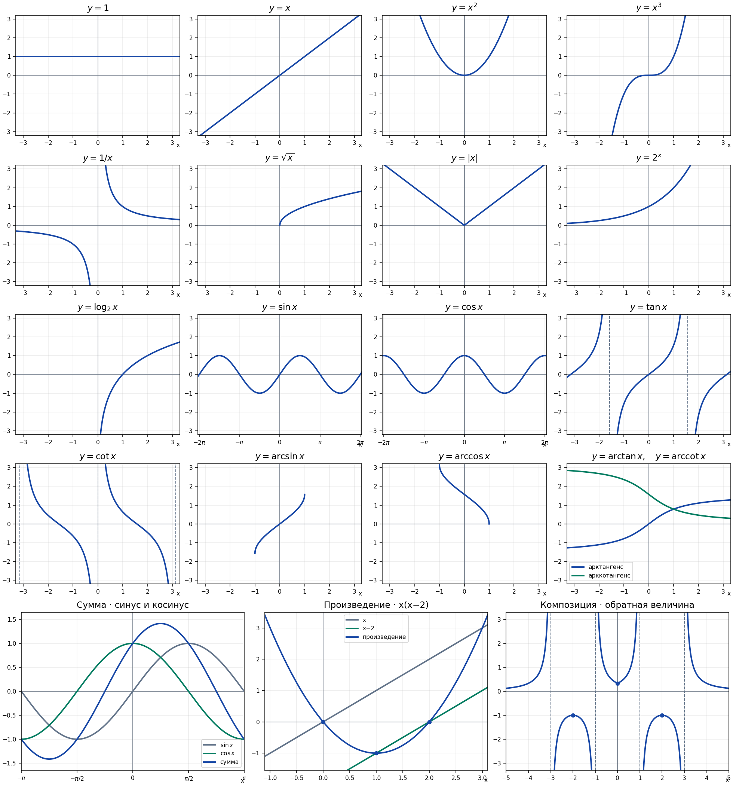
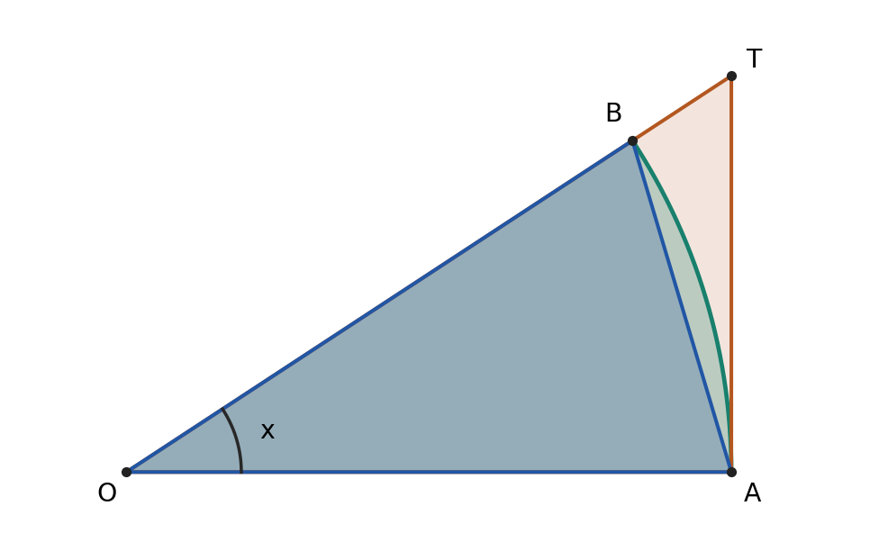
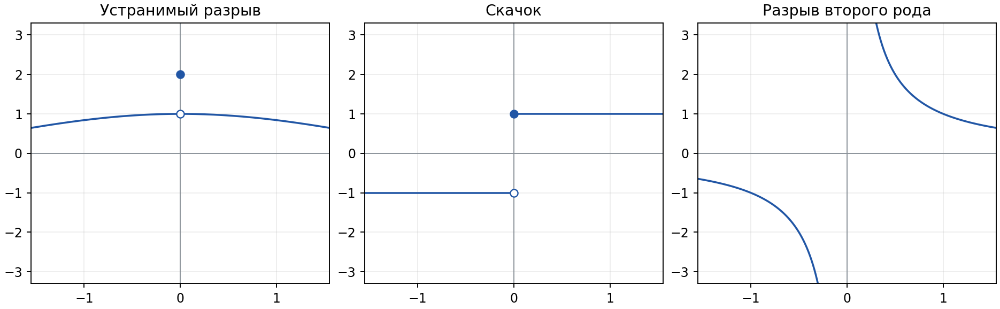

### №1. Графики

#### 1. Графики основных элементарных функций

Сначала отмечаем область определения $\operatorname{dom}(F)$, затем опорные точки и рисуем ветви. У периодической функции строим один период и повторяем его. Асимптоты проводим пунктиром.

| Функция | Как восстановить график |
|---|---|
| $y=c$ | Горизонтальная прямая через $(0,c)$. |
| $y=x$ | Прямая через $(0,0)$ и $(1,1)$. |
| $y=x^2$ | Парабола с вершиной $(0,0)$, ветвями вверх и точками $(\pm1,1)$. |
| $y=x^3$ | Возрастающая кривая через $(-1,-1)$, $(0,0)$, $(1,1)$. Симметрична относительно начала координат. |
| $y=\lvert x\rvert$ | Два луча с общей вершиной $(0,0)$, проходят через $(\pm1,1)$. |
| $y=\sqrt{x}$ | Начинается в $(0,0)$, проходит через $(1,1)$ и $(4,2)$. Область определения — $[0,+\infty)$. |
| $y=1/x$ | Ветви в I и III четвертях, точки $(1,1)$ и $(-1,-1)$. Асимптоты $x=0$ и $y=0$. |
| $y=a^x$, $a>0$, $a\ne1$ | Проходит через $(0,1)$ и $(1,a)$. Асимптота $y=0$. При $a>1$ возрастает, при $0<a<1$ убывает. |
| $y=\log_a x$, $a>0$, $a\ne1$ | Отражение экспоненты относительно $y=x$. Проходит через $(1,0)$ и $(a,1)$. Асимптота $x=0$. |
| $y=\sin x,\ y=\cos x$ | Период $2\pi$, значения в $[-1,1]$. Синус начинаем с $(0,0)$ и ведём вверх, косинус — с $(0,1)$ и ведём вниз. |
| $y=\tan x,\ y=\cot x$ | Период $\pi$. Тангенс возрастает на каждой ветви, асимптоты $x=\pi/2+\pi k$. Котангенс убывает на каждой ветви, асимптоты $x=\pi k$, где $k\in\mathbb Z$. |
| $y=\arcsin x,\ y=\arccos x$ | Область определения $[-1,1]$. Арксинус возрастает от $-\pi/2$ до $\pi/2$ и проходит через $(0,0)$. Арккосинус убывает от $\pi$ до $0$ и проходит через $(0,\pi/2)$. |
| $y=\arctan x,\ y=\operatorname{arccot}x$ | Область определения $\mathbb R$. Арктангенс возрастает, проходит через $(0,0)$, асимптоты $y=\pm\pi/2$. Арккотангенс убывает, проходит через $(0,\pi/2)$, асимптоты $y=0$ и $y=\pi$. |

**Преобразования.** Изменение аргумента двигает точки по горизонтали, изменение значения функции — по вертикали.

- $F(x+3)$ сдвигает график на 3 влево. Значение $F(0)$ теперь получается при $x=-3$, потому что $-3+3=0$.
- $F(x)+3$ поднимает каждую точку на 3.
- Для $F(|x|)$ сохраняем правую половину и зеркально переносим её влево.
- Для $|F(x)|$ сохраняем участки над $Ox$, а участки под осью отражаем вверх.

#### 2. Сумма двух функций

Для $H(x)=F(x)+G(x)$:

$$
\operatorname{dom}(H)=\operatorname{dom}(F)\cap\operatorname{dom}(G).
$$

Проводим вертикаль через выбранное $x$. Считываем высоты $F(x)$ и $G(x)$ со знаками, складываем их и на той же вертикали отмечаем высоту $H(x)$. Повторяем для опорных значений $x$.

**Пример.** $H(x)=\sin x+\cos x$.

| $x$ | $\sin x$ | $\cos x$ | $H(x)$ |
|---:|---:|---:|---:|
| $0$ | $0$ | $1$ | $1$ |
| $\pi/4$ | $\sqrt2/2$ | $\sqrt2/2$ | $\sqrt2$ |
| $\pi/2$ | $1$ | $0$ | $1$ |
| $3\pi/4$ | $\sqrt2/2$ | $-\sqrt2/2$ | $0$ |
| $5\pi/4$ | $-\sqrt2/2$ | $-\sqrt2/2$ | $-\sqrt2$ |

При $x=3\pi/4$ исходные точки находятся на одинаковой высоте по разные стороны от оси, поэтому точка суммы лежит на $Ox$. Формула $\sin x+\cos x=\sqrt2\sin(x+\pi/4)$ подтверждает форму графика. Это синусоида с амплитудой $\sqrt2$, сдвинутая влево на $\pi/4$.

#### 3. Произведение двух функций

Для $H(x)=F(x)G(x)$:

$$
\operatorname{dom}(H)=\operatorname{dom}(F)\cap\operatorname{dom}(G).
$$

На вертикали через выбранное $x$ считываем две высоты и **умножаем их**. Если первая точка на 3 единицы выше $Ox$, а вторая на 1 ниже, получаем $3\cdot(-1)=-3$. Новая точка лежит на той же вертикали на 3 единицы ниже оси.

1. **Отмечаем нули.** Если хотя бы один множитель равен нулю и обе функции определены в этой точке, произведение равно нулю.
2. **Определяем знаки.** Где оба графика по одну сторону от $Ox$, произведение положительно. Где они по разные стороны, произведение отрицательно.
3. **Вычисляем опорные высоты.** Знак показывает сторону от оси, а точки и вид функции определяют форму ветвей.

**Пример.** $F(x)=x$, $G(x)=x-2$.

| $x$ | $F(x)$ | $G(x)$ | $H(x)=F(x)G(x)$ |
|---:|---:|---:|---:|
| $-1$ | $-1$ | $-3$ | $3$ |
| $0$ | $0$ | $-2$ | $0$ |
| $1$ | $1$ | $-1$ | $-1$ |
| $2$ | $2$ | $0$ | $0$ |
| $3$ | $3$ | $1$ | $3$ |

Слева от нуля обе прямые ниже оси. Между $0$ и $2$ они по разные стороны от оси. Справа от $2$ обе прямые выше оси. Поэтому произведение положительно на $(-\infty,0)$ и $(2,+\infty)$ и отрицательно на $(0,2)$.

$$
x(x-2)=x^2-2x=(x-1)^2-1.
$$

Это график $y=x^2$, сдвинутый на 1 вправо и на 1 вниз. Вершина — $(1,-1)$, ось симметрии — $x=1$.

**Быстрые опорные точки.** Если $G(x)=1$, высота равна $F(x)$. Если $G(x)=-1$, высота равна $-F(x)$. Если $G(x)=0$, произведение попадает на $Ox$. Во всех трёх случаях $F(x)$ должна быть определена.

#### 4. Композиция двух функций

$$
x\xrightarrow{\,F\,}t=F(x)\xrightarrow{\,G\,}y=G(t).
$$

Для $H(x)=G(F(x))$:

$$
\operatorname{dom}(H)=\{x\in\operatorname{dom}(F)\mid F(x)\in\operatorname{dom}(G)\}.
$$

Сначала строим внутреннюю функцию $F$ и внешнюю $G$ отдельно. На оси $x$ отмечаем места, где $F(x)$ принимает запрещённые или важные для $G$ значения, и точки смены направления. Затем составляем таблицу $x$, $F(x)$, $G(F(x))$.

**Пример.**

$$
F(x)=(|x|-2)^2-1,\qquad G(t)=\frac1t,\qquad H(x)=\frac1{(|x|-2)^2-1}.
$$

1. Для $G$ запрещён ноль. Уравнение $(|x|-2)^2=1$ даёт $|x|=1$ или $|x|=3$. Исключаем $x=-3,-1,1,3$ из $\operatorname{dom}(H)$.
2. Добавляем точки смены направления $x=-2,0,2$. В них $F(-2)=-1$, $F(0)=3$, $F(2)=-1$.
3. Заполняем таблицу по промежуткам. В каждой строке $x$ движется слева направо. Записи $0^-$ и $0^+$ показывают, что значение приближается к нулю с отрицательной или положительной стороны.

| Промежуток $x$ | Как меняется $F(x)$ | Как меняется $H(x)=1/F(x)$ |
|---|---|---|
| $(-\infty,-3)$ | $+\infty\searrow0^+$ | $0^+\nearrow+\infty$ |
| $(-3,-2)$ | $0^-\searrow-1$ | $-\infty\nearrow-1$ |
| $(-2,-1)$ | $-1\nearrow0^-$ | $-1\searrow-\infty$ |
| $(-1,0)$ | $0^+\nearrow3$ | $+\infty\searrow1/3$ |
| $(0,1)$ | $3\searrow0^+$ | $1/3\nearrow+\infty$ |
| $(1,2)$ | $0^-\searrow-1$ | $-\infty\nearrow-1$ |
| $(2,3)$ | $-1\nearrow0^-$ | $-1\searrow-\infty$ |
| $(3,+\infty)$ | $0^+\nearrow+\infty$ | $+\infty\searrow0^+$ |

Например, на $(1,2)$ знаменатель начинает чуть ниже нуля и уменьшается до $-1$. Обратная величина начинает с очень большого отрицательного числа и поднимается к $-1$. Поэтому ветвь уходит вниз у $x=1$ и поднимается к $(2,-1)$.

Проводим вертикальные асимптоты $x=\pm1,\pm3$ и горизонтальную $y=0$. Отмечаем $(-2,-1)$, $(0,1/3)$ и $(2,-1)$ и рисуем ветви по таблице. В этих трёх опорных точках функция определена. На вертикальных асимптотах график прерывается.

**Сокращение.** $F(-x)=F(x)$, следовательно, $H(-x)=H(x)$. Для рисунка достаточно построить правую половину и отразить её относительно $Oy$.

---

#### Графики, источники и дополнения

- **Практика 02.09, листы 1–3.** Преобразования, примеры с экспонентой и котангенсом. На первом листе записано, что графики нумеруют, на одной системе координат размещают до трёх графиков и подписывают оси, точки и асимптоты. Перечень основных графиков дополнен.
- **Практика 09.09, листы 1–2.** Пример композиции, рисунок и идея таблицы. Таблица развёрнута с указанием направлений и односторонних значений.
- **Практика 09.09, лист 6.** Сумма синуса и косинуса нарисована как промежуточный график. Пошаговый алгоритм, таблица и проверка через формулу сложения добавлены.
- **Произведение.** Отдельного разбора на просмотренных листах нет. Алгоритм и пример добавлены для экзаменационного подпункта.
- **Лекция 04.09, лист 2.** В конспекте используются обозначения dom F и im F. Здесь они записаны со скобками.

[Архив конспектов с номерами листов](https://chatgpt.com/library?file_id=libfile_b37ff826499481918c215d25d84e5991&account_id=personal)

### №2. Элементы математической логики

#### 1. Таблицы истинности

**Высказывание** — утверждение, которому можно приписать одно из двух значений: $1$ — истина, $0$ — ложь. Например, «$2<5$» — истинное высказывание, «$7$ делится на $2$» — ложное.

| Обозначение | Как читается | Когда истинно |
|---|---|---|
| $\neg A$ | «Не $A$» | Когда $A$ ложно |
| $A\land B$ | «$A$ и $B$» | Когда истинны оба |
| $A\lor B$ | «$A$ или $B$» | Когда истинно хотя бы одно, в том числе когда истинны оба |
| $A\Rightarrow B$ | «Если $A$, то $B$» | Во всех случаях, кроме $A=1,\ B=0$ |
| $A\Leftrightarrow B$ | «$A$ тогда и только тогда, когда $B$» | Когда $A$ и $B$ имеют одинаковое значение |

| $A$ | $B$ | $\neg A$ | $A\land B$ | $A\lor B$ | $A\Rightarrow B$ | $A\Leftrightarrow B$ |
|---:|---:|---:|---:|---:|---:|---:|
| 0 | 0 | 1 | 0 | 0 | 1 | 1 |
| 0 | 1 | 1 | 0 | 1 | 1 | 0 |
| 1 | 0 | 0 | 0 | 1 | 0 | 0 |
| 1 | 1 | 0 | 1 | 1 | 1 | 1 |

**Как запомнить импликацию.** Утверждение «если число делится на $4$, то оно чётное» могло бы оказаться ложным, если бы нашлось число, которое делится на $4$ и при этом нечётное. Число $3$ этому утверждению не противоречит, потому что оно не делится на $4$. Поэтому при $A=0$ импликация получает значение $1$.

Если $A\Rightarrow B$, то $A$ — **достаточное** условие для $B$, а $B$ — **необходимое** для $A$. Если $A\Leftrightarrow B$, каждое условие необходимо и достаточно для другого. При доказательстве проверяем оба направления, $A\Rightarrow B$ и $B\Rightarrow A$.

#### 2. Принцип исключённого третьего

**Формулировка.** Для любого высказывания $A$ истинно высказывание $A\lor\neg A$:

$$
A\lor\neg A\equiv 1.
$$

**Проверка по таблице истинности.**

| $A$ | $\neg A$ | $A\lor\neg A$ |
|---:|---:|---:|
| 0 | 1 | 1 |
| 1 | 0 | 1 |

В каждой строке одна из частей дизъюнкции истинна. Например, для любого действительного $x$ верно «$x>0$ или $x\le 0$». Отрицание $x>0$ включает и случай $x=0$.

#### 3. Кванторы и предикаты

**Предикат** $P(x)$ — утверждение с переменной. После подстановки конкретного значения получается высказывание. Например, для $P(x)\colon x^2=1$ высказывание $P(-1)$ истинно, а $P(0)$ ложно.

**Квантор** указывает, для скольких элементов заданного множества выполняется предикат.

| Запись | Как читать | Пример |
|---|---|---|
| $\forall x\in X\ P(x)$ | Для каждого $x$ из $X$ верно $P(x)$ | $\forall x\in\mathbb R\quad x^2\ge0$ |
| $\exists x\in X\ P(x)$ | Найдётся хотя бы один $x$ из $X$, для которого верно $P(x)$ | $\exists x\in\mathbb R\quad x^2=1$ |
| $\exists!x\in X\ P(x)$ | Существует ровно один $x$ из $X$, для которого верно $P(x)$ | $\exists!x\in\mathbb R\quad x^2=0$ |

Для утверждения с $\forall$ доказательство должно работать для произвольного элемента множества. Чтобы опровергнуть его, достаточно **одного контрпримера**. Для $\exists$ достаточно предъявить подходящий элемент. Для $\exists!$ нужно показать **существование** и **единственность**.

##### Порядок кванторов

$$
\forall x\in\mathbb R\ \exists y\in\mathbb R\quad y>x,
\qquad
\exists y\in\mathbb R\ \forall x\in\mathbb R\quad y>x.
$$

Первая формула истинна. Для каждого $x$ можно подобрать своё $y$, например $y=x+1$. Вторая ложна. Она требует одного $y$ для всех $x$, но при $x=y$ неравенство $y>x$ уже нарушается.

В определении предела запись $\forall\varepsilon>0\ \exists N$ означает, что число $N$ может зависеть от выбранного $\varepsilon$.

#### 4. Правила построения отрицаний

##### Отрицание логических операций

| Исходное высказывание | Его отрицание |
|---|---|
| $\neg A$ | $A$ |
| $A\land B$ | $\neg A\lor\neg B$ |
| $A\lor B$ | $\neg A\land\neg B$ |
| $A\Rightarrow B$ | $A\land\neg B$ |
| $A\Leftrightarrow B$ | $(A\land\neg B)\lor(\neg A\land B)$ |

Отрицания «и» и «или» — **правила де Моргана**. В таблице для каждой пары $A,B$ значения левой и правой частей совпадают.

| $A$ | $B$ | $\neg(A\land B)$ | $\neg A\lor\neg B$ | $\neg(A\lor B)$ | $\neg A\land\neg B$ |
|---:|---:|---:|---:|---:|---:|
| 0 | 0 | 1 | 1 | 1 | 1 |
| 0 | 1 | 1 | 1 | 0 | 0 |
| 1 | 0 | 1 | 1 | 0 | 0 |
| 1 | 1 | 0 | 0 | 0 | 0 |

В столбце импликации ровно один ноль, в строке $A=1,\ B=0$. Следовательно, её отрицание истинно ровно в этой строке, как и $A\land\neg B$.

**Пример.** Отрицаем утверждение «$x>0$ и $x<3$»:

$$
\neg\bigl((x>0)\land(x<3)\bigr)
\ \Leftrightarrow\
(x\le0)\lor(x\ge3).
$$

На числовой прямой это дополнение к интервалу $(0,3)$:

$$
\underbrace{(-\infty,0]}_{\text{слева, включая }0}
\ \cup\
\underbrace{[3,+\infty)}_{\text{справа, включая }3}.
$$

При отрицании строгого неравенства равенство попадает в результат: $<$ меняется на $\ge$, а $>$ — на $\le$.

##### Отрицание кванторов

$$
\neg\bigl(\forall x\in X\ P(x)\bigr)
\ \Leftrightarrow\
\exists x\in X\ \neg P(x).
$$

Чтобы утверждение «все элементы удовлетворяют $P$» оказалось ложным, нужен хотя бы один элемент, для которого $P$ ложно.

$$
\neg\bigl(\exists x\in X\ P(x)\bigr)
\ \Leftrightarrow\
\forall x\in X\ \neg P(x).
$$

Утверждение «найдётся элемент, удовлетворяющий $P$» ложно, когда $P$ ложно для каждого элемента.

**Быстрый приём.** Проталкиваем отрицание от начала формулы к последнему условию. Меняем $\forall$ на $\exists$ и $\exists$ на $\forall$. **Порядок кванторов и множества, по которым они пробегают, сохраняются.** В конце отрицаем само условие.

**Пример на пределе последовательности.** Формула сходимости $a_n$ к числу $a$:

$$
\underbrace{\forall\varepsilon>0}_{\text{любая точность}}\quad
\underbrace{\exists N\in\mathbb N}_{\text{найдётся порог}}\quad
\underbrace{\forall n\in\mathbb N,\ n\ge N}_{\text{весь хвост}}
\quad |a_n-a|<\varepsilon.
$$

Её отрицание:

$$
\underbrace{\exists\varepsilon>0}_{\text{одна фиксированная точность}}\quad
\underbrace{\forall N\in\mathbb N}_{\text{любой порог}}\quad
\underbrace{\exists n\in\mathbb N,\ n\ge N}_{\text{найдётся член в хвосте}}
\quad |a_n-a|\ge\varepsilon.
$$

Существует фиксированная окрестность $a$, такая, что **после любого номера** найдётся член последовательности вне неё. Например, у $a_n=(-1)^n$ при $a=1$ и $\varepsilon=1$ после любого $N$ можно взять нечётное $n$. Тогда $a_n=-1$ и $|a_n-1|=2\ge1$.

---

#### Источники и дополнения

- **Лекция 04.09, лист 1** (Лекция_26.09.04_1.jpg). Таблицы истинности, принцип исключённого третьего, предикаты, обозначения $\forall,\exists,\exists!$, правила де Моргана, отрицание импликации и двух основных кванторов. Там же записаны формулировки про критерий, достаточное и необходимое условия.
- **Дополнения к листу.** Сводная таблица, проверки по таблицам, отрицание эквивалентности, разбор порядка кванторов и примеры с интервалом и последовательностью. Пример с пределом добавлен как подготовка к вопросу 8.

[Архив конспектов с номерами листов](https://chatgpt.com/library?file_id=libfile_b37ff826499481918c215d25d84e5991&account_id=personal)

### №3. Множества и отображения

#### 1. Отображение, область определения и множество значений

**Отображение** $F:X\to Y$ — правило, по которому каждому $x\in X$ соответствует ровно один элемент $y\in Y$. Пишем $y=F(x)$.

- **Область определения** $\operatorname{dom}(F)=X$ — все допустимые аргументы.
- **Множество значений** $\operatorname{im}(F)=\{F(x)\mid x\in X\}$ — все значения, которые действительно принимает $F$.
- $Y$ — множество, в которое задано отображение. Всегда $\operatorname{im}(F)\subseteq Y$.

Например, для $F:\mathbb R\to\mathbb R$, $F(x)=x^2$, область определения — $\mathbb R$, а множество значений — $[0,+\infty)$. Отрицательные числа входят в $Y$, но не получаются при вычислении $F(x)$.

#### 2. Равные отображения

В записи из конспекта $F=G$, если $\operatorname{dom}(F)=\operatorname{dom}(G)=X$ и $F(x)=G(x)$ для каждого $x\in X$. Если отображения заданы как $F,G:X\to Y$, множество назначения $Y$ у них уже общее.

**Проверяем и формулу, и область определения.** Например, $F(x)=x$ на $\mathbb R$ и $G(x)=x^2/x$ на $\mathbb R\setminus\{0\}$ совпадают при всех $x\ne0$. Однако $F(0)=0$, а $G(0)$ не определено, поэтому отображения различны.

#### 3. Образ и прообраз множества

Пусть $F:X\to Y$, $A\subseteq X$, $B\subseteq Y$.

**Образ** $A$ — множество значений, полученных из элементов $A$:

$$
F[A]=\{F(x)\mid x\in A\}
=\{y\in Y\mid \exists x\in A:\ F(x)=y\}.
$$

**Прообраз** $B$ — множество аргументов, которые отображаются в $B$:

$$
F^{-1}[B]=\{x\in X\mid F(x)\in B\}.
$$

| Операция | Что дано | Что ищем | Пример для $F(x)=x^2$ |
|---|---|---|---|
| Образ | Аргументы $A$ | Все полученные значения | $F[[-2,1]]=[0,4]$ |
| Прообраз | Значения $B$ | Все подходящие аргументы | $F^{-1}[[1,4]]=[-2,-1]\cup[1,2]$ |

В первом примере минимум достигается при $x=0$, максимум — при $x=-2$. Все промежуточные значения получаются уже на $[-2,0]$. Во втором примере решаем $1\le x^2\le4$, то есть $1\le |x|\le2$. Отсюда два промежутка. Если $B=\{-1\}$, прообраз пуст.

Запись $F^{-1}[B]$ означает **прообраз множества**. Она имеет смысл для любого $F$, даже если обратного отображения $F^{-1}:Y\to X$ нет.

#### 4. Сюръекция, инъекция и биекция

| Вид | Формулировка | Как проверить по стрелкам |
|---|---|---|
| **Сюръекция** | $\forall y\in Y\ \exists x\in X:\ F(x)=y$. Равносильно $\operatorname{im}(F)=Y$. | В каждый элемент $Y$ приходит хотя бы одна стрелка. |
| **Инъекция** | $\forall x_1,x_2\in X:\ F(x_1)=F(x_2)\Rightarrow x_1=x_2$. | В каждый элемент $Y$ приходит не больше одной стрелки. |
| **Биекция** | $F$ одновременно инъективно и сюръективно. | В каждый элемент $Y$ приходит ровно одна стрелка. |

| Отображение $F(x)=x^2$ | Инъекция | Сюръекция |
|---|---|---|
| $\mathbb R\to\mathbb R$ | Нет, $F(-1)=F(1)$. | Нет, значение $-1$ недостижимо. |
| $\mathbb R\to[0,+\infty)$ | Нет, та же пара аргументов. | Да, для каждого $y\ge0$ подойдёт $x=\sqrt y$. |
| $[0,+\infty)\to\mathbb R$ | Да, из $x_1^2=x_2^2$ при $x_1,x_2\ge0$ следует $x_1=x_2$. | Нет, значение $-1$ недостижимо. |
| $[0,+\infty)\to[0,+\infty)$ | Да. | Да. Получаем биекцию. |

Для доказательства инъективности начинаем с равенства $F(x_1)=F(x_2)$ и выводим $x_1=x_2$. Для доказательства сюръективности берём произвольное $y\in Y$ и решаем уравнение $F(x)=y$ с учётом $x\in X$.

#### 5. Обратное отображение

Если $F:X\to Y$ — биекция, то **обратное отображение** $F^{-1}:Y\to X$ задаётся условием

$$
F^{-1}(y)=x\quad\Longleftrightarrow\quad F(x)=y.
$$

**Почему оно существует и единственно.** Для каждого $y\in Y$ сюръективность гарантирует существование $x\in X$ с $F(x)=y$, а инъективность гарантирует единственность такого $x$. Поэтому это правило определяет ровно одно значение $F^{-1}(y)$ для каждого $y$. По определению,

$$
F^{-1}(F(x))=x,\qquad F(F^{-1}(y))=y.
$$

**Обратно, если отображение $G:Y\to X$ удовлетворяет обеим этим формулам в роли обратного, то $F$ — биекция.** Если $F(x_1)=F(x_2)$, применяем $G$ к обеим частям и получаем $x_1=x_2$. Для любого $y\in Y$ имеем $F(G(y))=y$, поэтому $y$ достигается при $x=G(y)$.

**Пример.** У $F(x)=\sin x$ на всей $\mathbb R$ нет обратного отображения: $F(0)=F(\pi)$. На $[-\pi/2,\pi/2]$ синус строго возрастает и принимает все значения из $[-1,1]$. Для $F:[-\pi/2,\pi/2]\to[-1,1]$ обратное отображение — $F^{-1}(y)=\arcsin y$.

#### 6. Композиция двух отображений

Пусть $F:X\to Y$, $G:Y\to Z$. Их **композиция** — отображение $G\circ F:X\to Z$:

$$
(G\circ F)(x)=G(F(x)).
$$

Сначала действует $F$, затем $G$. Значение $F(x)$ входит в $Y$, поэтому его можно подставить в $G$. Для функций с произвольными областями определения:

$$
\operatorname{dom}(G\circ F)=\{x\in\operatorname{dom}(F)\mid F(x)\in\operatorname{dom}(G)\}.
$$

**Пример.** Для $F(x)=x+1$, $G(x)=x^2$:

$$
(G\circ F)(x)=(x+1)^2,\qquad (F\circ G)(x)=x^2+1.
$$

При $x=1$ первая композиция даёт $4$, вторая — $2$. Порядок действий меняет результат.

---

#### Источники и дополнения

- **Лекция 04.09, лист 2** (Лекция_26.09.04_2.jpg). Множества, отображение, обозначения dom F и im F, равенство отображений, образ и прообраз. В записи прообраз введён для $B\subseteq\operatorname{im}(F)$. Здесь определение записано для любого $B\subseteq Y$: элементы вне $\operatorname{im}(F)$ не дают новых аргументов.
- **Лекция 04.09, лист 3** (Лекция_26.09.04_3.jpg). Сюръекция, инъекция и биекция.
- **Лекция 11.09, лист 1** (Лекция_26.09.11_1.jpg). Обратное отображение и пример с синусом и арксинусом.
- **Лекция 18.09, лист 2** (Лекция_26.09.18_2.jpg). Определение композиции двух отображений.
- **Дополнения.** Развёрнуто доказательство существования обратного отображения у биекции и обратное утверждение. Примеры с квадратом, сокращением дроби и перестановкой отображений добавлены для проверки определений.

[Архив конспектов с номерами листов](https://chatgpt.com/library?file_id=libfile_b37ff826499481918c215d25d84e5991&account_id=personal)

### №4. Определение множества действительных чисел

#### 1. Алгебраическое поле

**Алгебраическое поле** — множество $X$ с двумя операциями $+:X\times X\to X$ и $\cdot:X\times X\to X$, удовлетворяющими следующим аксиомам.

| Аксиома | Сложение | Умножение |
|---|---|---|
| Коммутативность | $x+y=y+x$ | $xy=yx$ |
| Ассоциативность | $x+(y+z)=(x+y)+z$ | $x(yz)=(xy)z$ |
| Нейтральный элемент | Существует $0\in X$, для которого $x+0=x$ при всех $x\in X$ | Существует $1\in X$, для которого $x\cdot1=x$ при всех $x\in X$ |
| Противоположный или обратный элемент | Для каждого $x\in X$ существует $-x\in X$, для которого $x+(-x)=0$ | Для каждого $x\ne0$ существует $x^{-1}\in X$, для которого $xx^{-1}=1$ |

Также $1\ne0$ и выполняется **дистрибутивность**:

$$
(x+y)z=xz+yz\qquad\text{для всех }x,y,z\in X.
$$

Например, $\mathbb Q$ с обычными операциями — поле. В $\mathbb Z$ число $2$ не имеет обратного по умножению внутри $\mathbb Z$, поскольку $1/2\notin\mathbb Z$.

##### Свойства поля и доказательства

**1. Нуль единственен.** Если $0_1$ и $0_2$ — два нейтральных элемента сложения, то $0_1+0_2=0_1$ по свойству $0_2$. По коммутативности и свойству $0_1$ та же сумма равна $0_2$. Значит, $0_1=0_2$.

**2. Единица единственна.** Если $1_1$ и $1_2$ — две единицы, то $1_1\cdot1_2=1_1$ по свойству $1_2$. По коммутативности и свойству $1_1$ то же произведение равно $1_2$. Следовательно, $1_1=1_2$.

**3. Для любого $x$ верно $x\cdot0=0$.** По дистрибутивности,

$$
x\cdot0=x(0+0)=x\cdot0+x\cdot0.
$$

Прибавляем к обеим частям противоположный элемент к $x\cdot0$ и получаем $0=x\cdot0$.

**4. Противоположный элемент единственен.** Пусть $x+u=0$ и $x+v=0$. Из $x+u=x+v$ прибавлением противоположного к $x$ и применением ассоциативности получаем $u=v$.

**5. Обратный элемент для $x\ne0$ единственен.** Пусть $xu=xv=1$. Умножаем $xu=xv$ на любой существующий обратный к $x$. По ассоциативности получаем $u=v$.

**6. Для любого $x$ верно $(-1)x=-x$.** По дистрибутивности и свойству 3,

$$
x+(-1)x=1\cdot x+(-1)x=(1+(-1))x=0\cdot x=0.
$$

Значит, $(-1)x$ — противоположный элемент к $x$. По свойству 4 он равен $-x$. Вывод работает и при $x=0$.

#### 2. Линейно упорядоченное множество

**Отношение частичного порядка** $\le$ на множестве $X$ удовлетворяет трём свойствам:

| Свойство | Формула |
|---|---|
| Рефлексивность | $x\le x$ |
| Антисимметричность | $(x\le y)\land(y\le x)\Rightarrow x=y$ |
| Транзитивность | $(x\le y)\land(y\le z)\Rightarrow x\le z$ |

Множество $X$ **линейно упорядочено**, если на нём задан частичный порядок и любые два элемента сравнимы:

$$
\forall x,y\in X\quad (x\le y)\lor(y\le x).
$$

Строгий порядок задаём так: $x<y$ означает $x\le y$ и $x\ne y$. Полезная формула из конспекта:

$$
x=y\quad\Longleftrightarrow\quad (x\le y)\land(y\le x).
$$

Направление вправо следует из рефлексивности, направление влево — из антисимметричности.

**Пример частичного порядка.** На подмножествах $\{1,2\}$ можно взять отношение включения $\subseteq$. Множества $\{1\}$ и $\{2\}$ несравнимы: ни одно не включено в другое. Поэтому этот порядок частичный, а для линейного нужна сравнимость и этой пары.

#### 3. Линейно упорядоченное алгебраическое поле

Это алгебраическое поле $X$, на котором задан линейный порядок $\le$, согласованный с операциями:

$$
\forall x,y,z\in X\quad x\le y\Rightarrow x+z\le y+z,
$$

$$
\forall x,y\in X\quad (x\ge0)\land(y\ge0)\Rightarrow xy\ge0.
$$

Первое условие разрешает прибавлять одно и то же число к обеим частям неравенства. Второе фиксирует знак произведения неотрицательных элементов.

##### Свойства порядка и доказательства

**1. Если $x<y$, то $x+z<y+z$.** Аксиома даёт $x+z\le y+z$. Равенство привело бы к $x=y$ после прибавления $-z$. Значит, неравенство строгое.

**2. Если $x>0$, то $-x<0$.** К $0<x$ прибавляем $-x$ и по свойству 1 получаем $-x<0$. Аналогично, из $y\le0$ прибавлением $-y$ следует $0\le -y$.

**3. Если $x>0$ и $y>0$, то $xy>0$.** По аксиоме $xy\ge0$. Если бы $xy=0$, то умножением на $x^{-1}$ получили бы $y=0$, что противоречит $y>0$. Следовательно, $xy>0$.

**4. Если $x\ge0$ и $y\le0$, то $xy\le0$.** Из $y\le0$ следует $-y\ge0$. Значит, $x(-y)\ge0$. Кроме того,

$$
xy+x(-y)=x(y+(-y))=x\cdot0=0.
$$

Прибавив $xy$ к обеим частям $0\le x(-y)$, получаем $xy\le0$.

#### 4. Полное линейно упорядоченное алгебраическое поле

Линейно упорядоченное алгебраическое поле $X$ называется **полным**, если для любых непустых $X_1,X_2\subseteq X$ выполняется условие:

$$
\bigl(\forall x_1\in X_1\ \forall x_2\in X_2\quad x_1\le x_2\bigr)
\ \Longrightarrow\
\bigl(\exists y\in X\ \forall x_1\in X_1\ \forall x_2\in X_2\quad x_1\le y\le x_2\bigr).
$$

Если каждый элемент $X_1$ лежит левее или совпадает с каждым элементом $X_2$, то в поле есть **одно общее число** $y$, которое отделяет всё $X_1$ от всего $X_2$. Оно может совпадать с крайним элементом одного из множеств.

| Что проверяем | Что добавляется |
|---|---|
| Поле | Сложение и умножение с их аксиомами |
| Линейно упорядоченное поле | Сравнимость любых двух элементов и согласованность порядка с операциями |
| Полное линейно упорядоченное поле | Существование разделяющего элемента для любой пары непустых множеств из определения |

**Почему полнота нужна отдельно.** Рассмотрим в $\mathbb Q$ два непустых множества

$$
X_1=\{q\in\mathbb Q\mid q\ge0,\ q^2<2\},\qquad
X_2=\{q\in\mathbb Q\mid q\ge0,\ q^2>2\}.
$$

Квадрат строго возрастает на неотрицательных числах, поэтому каждый элемент $X_1$ меньше каждого элемента $X_2$. Допустим, рациональное $y$ разделяет их. Поскольку $1\in X_1$ и $2\in X_2$, имеем $1\le y\le2$. Возьмём рациональное $z=\dfrac{2y+2}{y+2}>0$. Тогда

$$
z-y=\frac{2-y^2}{y+2},\qquad
z^2-2=\frac{2(y^2-2)}{(y+2)^2}.
$$

- При $y^2<2$ получаем $z\in X_1$ и $z>y$. Это нарушает условие $x_1\le y$.
- При $y^2>2$ получаем $z\in X_2$ и $z<y$. Это нарушает условие $y\le x_2$.

Остаётся $y^2=2$. Если $y=m/n$ — несократимая дробь, то $m^2=2n^2$, поэтому $m$ чётно. Подстановка $m=2k$ даёт $n^2=2k^2$, значит, $n$ тоже чётно. Это противоречит несократимости. Рационального разделяющего числа нет.

#### 5. Определение множества действительных чисел

**Множеством действительных чисел $\mathbb R$ называется полное линейно упорядоченное алгебраическое поле.** В ответе раскрываем, какие операции задают поле, как порядок согласован с ними и в чём состоит полнота. Полнота здесь входит в определение. Принцип точной верхней грани, который из неё выводится, относится к вопросу 6.

---

#### Источники и дополнения

- **Лекция 11.09, листы 2–4** (Лекция_26.09.11_2.jpg — Лекция_26.09.11_4.jpg). Аксиомы поля, свойства поля, линейный порядок, согласование порядка с операциями, полнота в формулировке через два множества и определение $\mathbb R$.
- **Лекция 11.09, листы 6–7** (Лекция_26.09.11_6.jpg — Лекция_26.09.11_7.jpg). Список свойств поля и записи доказательств пунктов 1–5. На листе 7 у пункта 6 виден только номер. Доказательство $(-1)x=-x$ дописано. В конспекте условие пункта 6 записано при $x\ne0$. Приведённое доказательство охватывает также $x=0$.
- **Дополнения.** Развёрнуты аксиомы частичного порядка и доказательства четырёх свойств линейно упорядоченного поля. Добавлен пример неполноты $\mathbb Q$ с доказательством на рациональных числах.

[Архив конспектов с номерами листов](https://chatgpt.com/library?file_id=libfile_b37ff826499481918c215d25d84e5991&account_id=personal)

### №5. Подмножества множества действительных чисел

#### 1. Натуральные, целые, рациональные и иррациональные числа

| Множество | Определение | Примеры |
|---|---|---|
| $\mathbb N$ | Натуральные числа $1,2,3,\ldots$. В обозначениях курса начинаем с $1$. | $1,7,100$ |
| $\mathbb Z$ | Натуральные числа, противоположные им числа и нуль. | $-3,0,5$ |
| $\mathbb Q$ | Числа вида $m/n$, где $m\in\mathbb Z$, $n\in\mathbb N$. Разные дроби могут обозначать одно число. | $-2/3,0,5/2$ |
| $\mathbb R\setminus\mathbb Q$ | Действительные числа, которые нельзя представить в виде такой дроби. | $\sqrt2,\pi$ |

Вложения имеют вид $\mathbb N\subsetneq\mathbb Z\subsetneq\mathbb Q\subsetneq\mathbb R$. Строгость можно показать числами $0$, $1/2$ и $\sqrt2$ соответственно.

#### 2. Счётное и несчётное множество

Два множества **равномощны**, если между ними существует биекция. Множество $X$ называется **счётным**, если существует биекция $\mathbb N\to X$. Его элементы можно записать в список $x_1,x_2,\ldots$ так, чтобы каждый элемент встретился ровно один раз. Бесконечное множество, для которого такой список невозможен, называется **несчётным**.

Например, $\mathbb Z$ счётно: $0,1,-1,2,-2,3,-3,\ldots$. При счётности важно, что каждый элемент имеет **конечный номер**.

#### 3. Теорема о счётности множества рациональных чисел

**Формулировка.** Множество $\mathbb Q$ счётно.

**Доказательство.** Сначала выписываем все дроби $m/n$ с $m,n\in\mathbb N$. Перебираем пары по возрастанию $m+n$. Каждая строка ниже — одна диагональ таблицы дробей.

| $m+n$ | Пары $(m,n)$ | Дроби |
|---:|---|---|
| $2$ | $(1,1)$ | $1/1$ |
| $3$ | $(1,2),(2,1)$ | $1/2,\ 2/1$ |
| $4$ | $(1,3),(2,2),(3,1)$ | $1/3,\ 2/2,\ 3/1$ |
| $5$ | $(1,4),(2,3),(3,2),(4,1)$ | $1/4,\ 2/3,\ 3/2,\ 4/1$ |

Для любой дроби $m/n$ её пара встретится на диагонали с номером $m+n$. До этой диагонали просмотрено конечное число пар. Повторы пропускаем, например $2/2=1/1$ уже было. Получаем список всех положительных рациональных чисел $r_1,r_2,\ldots$ без повторов. Список бесконечен, поскольку включает все натуральные числа.

Добавляем нуль и отрицательные числа:

$$
0,\ r_1,\ -r_1,\ r_2,\ -r_2,\ldots
$$

У нуля номер $1$, у $r_k$ номер $2k$, у $-r_k$ номер $2k+1$. Каждое рациональное число встречается ровно один раз. Значит, построена биекция между $\mathbb N$ и $\mathbb Q$.

#### 4. Теорема о несчётности множества действительных чисел

**Формулировка.** Множество $\mathbb R$ несчётно.

**Доказательство Кантора.** Если бы $\mathbb R$ можно было перечислить, из списка можно было бы оставить только числа из $(0,1)$ и получить список всех элементов этого интервала. Предположим, что такой список существует. Каждое число записываем десятичной дробью, выбирая запись без бесконечного хвоста из девяток. Например, для $0{,}5$ берём $0{,}5000\ldots$.

| Номер | Запись числа | Цифра, которую используем |
|---:|---|---|
| $1$ | $0{,}a_{11}a_{12}a_{13}\ldots$ | $a_{11}$ |
| $2$ | $0{,}a_{21}a_{22}a_{23}\ldots$ | $a_{22}$ |
| $3$ | $0{,}a_{31}a_{32}a_{33}\ldots$ | $a_{33}$ |
| $n$ | $0{,}a_{n1}a_{n2}a_{n3}\ldots$ | $a_{nn}$ |

Строим число $b=0{,}b_1b_2b_3\ldots$. Если $a_{nn}=1$, ставим $b_n=2$. Во всех остальных случаях ставим $b_n=1$. Поэтому $b_n\ne a_{nn}$ при любом $n$. Число $b$ лежит в $(0,1)$, его запись тоже без хвоста из девяток. Оно отличается от первого числа первой цифрой, от второго — второй и вообще от $n$-го — $n$-й. Значит, $b$ отсутствует в списке, хотя список должен содержать весь интервал. Противоречие.

#### 5. Интервал, отрезок и промежуток

Для $a<b$:

| Вид | Обозначение | Условие на $x$ |
|---|---|---|
| Интервал | $(a;b)$ | $a<x<b$ |
| Отрезок | $[a;b]$ | $a\le x\le b$ |
| Полуинтервал | $[a;b)$ | $a\le x<b$ |
| Полуинтервал | $(a;b]$ | $a<x\le b$ |

**Числовой промежуток** — множество, содержащее вместе с любыми двумя своими точками все числа между ними. К промежуткам относятся также лучи, например $(-\infty;a]$ и $(a;+\infty)$, вся $\mathbb R$ и одноточечный отрезок $[a;a]$.

#### 6. Окрестности

**Окрестность** точки $x_0$ — интервал, содержащий $x_0$. При $\varepsilon>0$ симметричная **$\varepsilon$-окрестность** задаётся так:

$$
O_\varepsilon(x_0)=(x_0-\varepsilon;x_0+\varepsilon)
=\{x\in\mathbb R\mid |x-x_0|<\varepsilon\}.
$$

**Проколотая $\varepsilon$-окрестность** получается удалением самой точки $x_0$:

$$
\mathring O_\varepsilon(x_0)
=(x_0-\varepsilon;x_0)\cup(x_0;x_0+\varepsilon)
=\{x\in\mathbb R\mid 0<|x-x_0|<\varepsilon\}.
$$

Например, $O_1(2)=(1;3)$, а $\mathring O_1(2)=(1;2)\cup(2;3)$.

#### 7. Внутренняя и предельная точки

**Внутренняя точка** $x_0$ множества $X\subseteq\mathbb R$ — точка, у которой существует окрестность, целиком лежащая в $X$:

$$
\exists\varepsilon>0\quad O_\varepsilon(x_0)\subseteq X.
$$

**Предельная точка** $x_0$ множества $X$ — точка, в каждой окрестности которой есть точка $X$, отличная от $x_0$:

$$
\forall\varepsilon>0\quad
\mathring O_\varepsilon(x_0)\cap X\ne\varnothing.
$$

| Множество | Точка | Внутренняя | Предельная |
|---|---|---|---|
| $(0;1)$ | $1/2$ | Да, например, подходит окрестность радиуса $1/4$. | Да, в любой окрестности есть другие точки интервала. |
| $(0;1)$ | $0$ | Нет, точка не входит в множество. | Да, положительные числа интервала подходят сколь угодно близко к нулю. |
| $\{0\}$ | $0$ | Нет, ни одна окрестность целиком не помещается в $\{0\}$. | Нет, после удаления нуля пересечение пусто. |

**Как различать.** Для внутренней точки нужна **одна целая** окрестность внутри $X$. Для предельной — **в каждой** окрестности нужна **хотя бы одна другая** точка $X$. Сама предельная точка может лежать вне $X$.

#### 8. Открытое и замкнутое множества

**Открытое множество** — множество, все точки которого внутренние. Например, у любой точки $x$ интервала $(a;b)$ можно взять радиус $\varepsilon=\tfrac12\min(x-a,b-x)>0$. Вся такая окрестность лежит в $(a;b)$.

**Замкнутое множество** — множество, содержащее все свои предельные точки. Например, $[a;b]$ замкнуто. Для $x<a$ окрестность радиуса $(a-x)/2$ не пересекает отрезок, а для $x>b$ подходит радиус $(x-b)/2$. Поэтому ни одна точка за пределами отрезка не может быть его предельной точкой.

Для сравнения, $[0;1)$ не открыто из-за точки $0$ и не замкнуто из-за отсутствующей предельной точки $1$.

---

#### Источники и дополнения

- **Лекция 11.09, листы 4–5.** Числовые множества, равномощность и счётность, диагональный перебор рациональных дробей. Таблица развёрнута по суммам числителя и знаменателя. Порядок дробей внутри диагонали можно выбрать произвольно.
- **Лекция 18.09, листы 1–2.** Доказательство несчётности через десятичные дроби. Уточнены выбор цифр $1$ и $2$ и правило записи без хвоста из девяток.
- **Лекция 18.09, лист 4.** Промежутки, окрестности, внутренние и предельные точки, открытые и замкнутые множества. Обозначения окрестностей оформлены единообразно, примеры и обоснования добавлены.

[Архив конспектов с номерами листов](https://chatgpt.com/library?file_id=libfile_b37ff826499481918c215d25d84e5991&account_id=personal)

### №6. Принцип точной верхней грани. Аксиома Архимеда

#### 1. Верхняя и нижняя грани

Пусть $X\subseteq\mathbb R$.

| Понятие | Условие |
|---|---|
| $M$ — верхняя грань $X$ | $\forall x\in X\quad x\le M$ |
| $m$ — нижняя грань $X$ | $\forall x\in X\quad m\le x$ |
| $X$ ограничено сверху | У $X$ есть хотя бы одна верхняя грань. |
| $X$ ограничено снизу | У $X$ есть хотя бы одна нижняя грань. |
| $X$ ограничено | Оно ограничено и сверху, и снизу. Иными словами, $X\subseteq[m;M]$ для некоторых $m,M\in\mathbb R$ с $m\le M$. |

Для $X=(0;1)$ любое $M\ge1$ — верхняя грань, любое $m\le0$ — нижняя. Грань может находиться за пределами множества.

#### 2. Максимум, минимум и точные грани

| Понятие | Формулировка |
|---|---|
| $\max X$ | Элемент $a\in X$, для которого $\forall x\in X\quad x\le a$. |
| $\min X$ | Элемент $b\in X$, для которого $\forall x\in X\quad b\le x$. |
| $\sup X$ | Наименьшая верхняя грань $X$. |
| $\inf X$ | Наибольшая нижняя грань $X$. |

У $(0;1)$ имеем $\inf X=0$ и $\sup X=1$. Если предложить верхнюю грань $M<1$, в интервале найдётся число больше $M$. Например, при $0\le M<1$ подойдёт $(M+1)/2$, а при $M<0$ подойдёт $1/2$. Аналогично любое число больше $0$ слишком велико для нижней грани. Максимума и минимума у этого интервала нет, поскольку концы в него не входят. У $[0;1]$ те же точные грани, и обе достигаются.

**Как узнать точную грань.** Для непустого $X$ число $s$ равно $\sup X$ тогда и только тогда, когда выполнены два условия:

$$
\forall x\in X\quad x\le s,
\qquad
\forall\varepsilon>0\ \exists x\in X\quad s-\varepsilon<x.
$$

**Доказательство.** Если $s=\sup X$, то $s$ — верхняя грань. Число $s-\varepsilon$ меньше $s$, поэтому оно уже не может быть верхней гранью. Значит, в $X$ есть элемент больше $s-\varepsilon$. Обратно, первое условие делает $s$ верхней гранью. Для любого $M<s$ берём $\varepsilon=s-M$ и по второму условию находим $x>M$. Поэтому никакое $M<s$ не является верхней гранью, а $s=\sup X$.

Аналогично $t=\inf X$ тогда и только тогда, когда $t\le x$ для всех $x\in X$ и при каждом $\varepsilon>0$ найдётся $x\in X$ с $x<t+\varepsilon$. Доказательство получается применением критерия для супремума к $-X=\{-x\mid x\in X\}$: $m$ является нижней гранью $X$ ровно тогда, когда $-m$ является верхней гранью $-X$.

#### 3. Принцип точной верхней и нижней грани

**Формулировка.** У любого непустого ограниченного сверху множества $X\subseteq\mathbb R$ есть единственная точная верхняя грань. У любого непустого ограниченного снизу множества есть единственная точная нижняя грань.

**Доказательство для верхней грани.** Пусть $Y$ — множество всех верхних граней $X$. Оно непусто по условию. Для любых $x\in X$ и $y\in Y$ верно $x\le y$. По полноте $\mathbb R$ существует $s\in\mathbb R$, для которого

$$
x\le s\le y\qquad\text{для всех }x\in X,\ y\in Y.
$$

Из $x\le s$ следует $s\in Y$. Из $s\le y$ следует, что $s$ — наименьший элемент $Y$. Это и означает $s=\sup X$. Если бы $s'$ тоже был наименьшим элементом $Y$, то $s\le s'$ и $s'\le s$. По антисимметричности $s=s'$.

**Доказательство для нижней грани.** Если $X$ ограничено снизу, то $-X$ ограничено сверху и имеет супремум $s$. Из $-x\le s$ для всех $x\in X$ следует $-s\le x$, поэтому $-s$ — нижняя грань $X$. Если $m$ — любая нижняя грань $X$, то $-m$ — верхняя грань $-X$, значит, $s\le -m$ и $m\le -s$. Следовательно, $-s=\inf X$. Единственность следует из антисимметричности, как и для супремума.

#### 4. Следствие о максимуме и минимуме

**Формулировка.** Если $\sup X$ существует, то $\max X$ существует ровно тогда, когда $\sup X\in X$. В этом случае $\max X=\sup X$. Аналогично $\min X$ существует ровно тогда, когда $\inf X\in X$, и тогда $\min X=\inf X$.

**Доказательство.** Если $\sup X\in X$, то он принадлежит множеству и не меньше всех его элементов, то есть является максимумом. Обратно, если $a=\max X$, то $a$ — верхняя грань, а любая верхняя грань $M$ удовлетворяет $M\ge a$, поскольку $a\in X$. Поэтому $a=\sup X$. Для минимума те же шаги с обратными неравенствами: $\inf X\in X$ даёт минимум, а любая нижняя грань не превосходит $\min X$, если минимум существует.

#### 5. Следствие о неограниченности натуральных чисел сверху

**Формулировка.** Для каждого $M\in\mathbb R$ существует $n\in\mathbb N$ с $n>M$.

**Доказательство.** Предположим, что $\mathbb N$ ограничено сверху. По принципу точной верхней грани существует $s=\sup\mathbb N$. Число $s-1$ меньше $s$, поэтому не является верхней гранью. Находим $n\in\mathbb N$ с $n>s-1$. Тогда $n+1>s$, но $n+1\in\mathbb N$. Это противоречит тому, что $s$ — верхняя грань.

**Приём доказательства.** Сдвигаем предполагаемый супремум на единицу вниз, находим натуральное число выше этой отметки, затем прибавляем к нему единицу.

#### 6. Принцип Архимеда

**Формулировка в записи через шаг $h$.** Для каждого $x\in\mathbb R$ и каждого $h>0$ существует единственное $k\in\mathbb Z$ такое, что

$$
(k-1)h\le x<kh.
$$

На прямой отмечаем соседние кратные $h$. Число $x$ попадает ровно в один полуинтервал $[(k-1)h;kh)$. Например, при $x=-2{,}3$ и $h=1$ получаем $-3\le -2{,}3<-2$, поэтому $k=-2$.

**Существование.** Возьмём множество $A=\{n\in\mathbb Z\mid n>x/h\}$. По неограниченности $\mathbb N$ сверху найдётся $N\in\mathbb N$ с $N>|x/h|$. Значит, $N\in A$, а любое $n\in A$ больше $-N$. Сдвинем все элементы $A$ на $N$. Получится непустое подмножество $\mathbb N$, у которого по принципу наименьшего элемента есть минимум. После сдвига обратно получаем $k=\min A$.

Из $k\in A$ следует $x/h<k$. Поскольку $k-1$ меньше минимума $A$, имеем $k-1\notin A$, то есть $k-1\le x/h$. Умножаем обе части на $h>0$.

**Единственность.** Если бы подходили два целых $k<\ell$, то $k\le\ell-1$. Тогда

$$
x<kh\le(\ell-1)h\le x,
$$

что невозможно.

**Две полезные формы.**

- Если $x>0$ и $h>0$, существует $n\in\mathbb N$ с $nh>x$. Достаточно выбрать натуральное $n>x/h$.
- При $h=1$ после замены $m=k-1$ получаем $m\le x<m+1$, где $m=\lfloor x\rfloor$ — наибольшее целое, не превосходящее $x$. Для $x=-2{,}3$ это $m=-3$.

---

#### Источники и дополнения

- **Лекция 18.09, лист 2.** Ограниченность, грани, максимум, минимум, супремум и инфимум. На листе есть сравнение открытого и замкнутого единичных промежутков.
- **Лекция 18.09, лист 3.** Доказательство принципа точной верхней грани через множество всех верхних граней. Для нижней грани в записи указан аналогичный вывод, здесь он раскрыт через $-X$. Там же записан принцип Архимеда и ход доказательства через наименьшее целое выше $x/h$.
- **Лекция 18.09, лист 4.** Наибольшее целое, не превосходящее $x$, и пример с отрицательным числом.
- **Дополнения.** Расписаны доказательства следствий из точной грани, критерий через $\varepsilon$ и единственность в принципе Архимеда. В доказательстве существования отдельно показано, почему множество целых кандидатов имеет минимум.

[Архив конспектов с номерами листов](https://chatgpt.com/library?file_id=libfile_b37ff826499481918c215d25d84e5991&account_id=personal)

### №7. Основные принципы теории действительных чисел

#### 1. Последовательность вложенных отрезков

Пусть $I_n=[a_n;b_n]$, $a_n\le b_n$. Отрезки называются вложенными, если $I_{n+1}\subseteq I_n$ для каждого $n$. Тогда $a_n\le a_{n+1}\le b_{n+1}\le b_n$. Левые концы сдвигаются вправо, правые — влево.

#### 2. Принцип вложенных отрезков Коши–Кантора

**Формулировка.** У любой последовательности непустых вложенных отрезков существует общая точка. Если $b_n-a_n\to0$, общая точка единственна.

**Доказательство существования.** Для любых $n,k$ отрезок $I_{\max(n,k)}$ лежит в обоих, поэтому $a_n\le b_k$. Множество левых концов непусто и ограничено сверху каждым $b_k$. Положим $c=\sup\{a_n:n\in\mathbb N\}$. Тогда $a_k\le c\le b_k$ для каждого $k$, то есть $c$ лежит во всех отрезках.

**Единственность.** Если $c<d$ — две общие точки, то $d-c\le b_n-a_n$ при каждом $n$. Для достаточно большого $n$ длина отрезка меньше положительного числа $d-c$. Противоречие.

Пример: $I_n=[0;1/n]$ имеет единственную общую точку $0$. У постоянной последовательности $I_n=[0;1]$ общих точек целый отрезок.

#### 3. Покрытие, подпокрытие, открытое и конечное покрытия

Семейство $\{U_\alpha\}_{\alpha\in A}$ — **покрытие** $X$, если $X\subseteq\bigcup_{\alpha\in A}U_\alpha$. **Подпокрытие** — подсемейство исходного покрытия, которое всё ещё покрывает $X$.

| Вид покрытия | Что проверяем |
|---|---|
| Открытое | Каждое $U_\alpha$ открыто. |
| Конечное | В семействе конечное число множеств. |
| Конечное подпокрытие | Можно выбрать конечное число исходных множеств, сохранив покрытие всего $X$. |

#### 4. Принцип конечного покрытия Бореля–Лебега

**Формулировка.** Из любого открытого покрытия отрезка $[a;b]$ можно выделить конечное подпокрытие.

**Доказательство.** Предположим, что конечного подпокрытия нет. Делим отрезок пополам. Хотя бы одна половина тоже не допускает конечного подпокрытия: иначе объединение двух конечных наборов покрыло бы весь отрезок. Повторяем деление выбранной половины. Получаем вложенные отрезки $I_n$ с длиной $(b-a)/2^n$, ни один из которых не покрывается конечным набором.

По принципу Коши–Кантора есть общая точка $c$. Какое-то открытое множество $U$ покрытия содержит $c$ и вместе с ним целую окрестность $(c-\varepsilon;c+\varepsilon)$. При длине $I_n<\varepsilon$ весь $I_n$ лежит в этой окрестности, потому что $c\in I_n$. Значит, одного $U$ достаточно для покрытия $I_n$. Противоречие.

**Почему важно, что взят отрезок.** Открытые интервалы $(1/n;1)$ при $n\ge2$ покрывают $(0;1)$, но любой конечный набор оставляет непокрытыми точки достаточно близко к нулю.

#### 5. Принцип предельной точки Больцано–Вейерштрасса

**Формулировка.** У всякого бесконечного ограниченного множества $X\subseteq\mathbb R$ есть хотя бы одна предельная точка.

**Доказательство.** Помещаем $X$ в отрезок $[a;b]$ и делим его пополам. Хотя бы в одной половине бесконечно много точек $X$: объединение двух конечных множеств было бы конечным. Выбираем такую половину и повторяем. По Коши–Кантору у вложенных отрезков есть общая точка $c$. Для любого $\varepsilon>0$ достаточно короткий отрезок лежит в $(c-\varepsilon;c+\varepsilon)$. В нём бесконечно много точек $X$, поэтому найдётся хотя бы одна, отличная от $c$. По определению $c$ — предельная точка.

**Как отличить два доказательства.** В обоих делим отрезок пополам. Для Бореля–Лебега сохраняем отсутствие конечного подпокрытия, для Больцано–Вейерштрасса — бесконечное число точек.

---

#### Источники и дополнения

- **Лекция 25.09, листы 1–3.** Вложенные отрезки, доказательство Коши–Кантора, определения покрытий, формулировки Бореля–Лебега и Больцано–Вейерштрасса. Доказательства двух последних принципов развёрнуты методом деления отрезка пополам, добавлены примеры.

[Архив конспектов](https://chatgpt.com/library?file_id=libfile_b37ff826499481918c215d25d84e5991&account_id=personal)

### №8. Определение предела числовой последовательности и его свойства

#### 1. Числовая последовательность и её предел

Числовая последовательность — отображение $\mathbb N\to\mathbb R$, $n\mapsto a_n$. Число $a$ называется **пределом** последовательности $(a_n)$, если

$$
\forall\varepsilon>0\ \exists N=N(\varepsilon)\in\mathbb N\
\forall n>N:\quad |a_n-a|<\varepsilon.
$$

Пишем $a_n\to a$ или $\lim_{n\to\infty}a_n=a$. При любом заранее выбранном радиусе $\varepsilon$ весь хвост лежит в полосе $a-\varepsilon<a_n<a+\varepsilon$. Номер $N$ можно выбрать после того, как задано $\varepsilon$.

**Пример.** Докажем $n/(n+1)\to1$. Имеем $|n/(n+1)-1|=1/(n+1)$. Нужно $n+1>1/\varepsilon$. Достаточно взять $N=\max(1,\lceil1/\varepsilon\rceil)$. Тогда при $n>N$ нужное неравенство выполнено.

#### 2. Ограниченная последовательность

$(a_n)$ ограничена, если $\exists C>0\ \forall n\in\mathbb N:\ |a_n|\le C$. Это равносильно существованию нижней и верхней границ для всех членов последовательности. Например, $a_n=(-1)^n$ ограничена числом $C=1$.

#### 3. Свойства предела

##### Любая окрестность предела содержит все члены, кроме, возможно, конечного числа

**Доказательство.** В любой окрестности $a$ помещается $(a-\varepsilon;a+\varepsilon)$ для некоторого $\varepsilon>0$. По определению все $a_n$ с $n>N(\varepsilon)$ лежат в этом интервале. Вне исходной окрестности могут оказаться только члены с номерами от $1$ до $N$.

##### Сходящаяся последовательность ограничена

**Доказательство.** Для $\varepsilon=1$ найдётся $N$, после которого $|a_n-a|<1$, откуда $|a_n|\le|a|+|a_n-a|<|a|+1$. Первых членов конечное число. Поэтому для всех $n$ подходит одно число

$$
C=\max\{|a_1|,\ldots,|a_N|,|a|+1\}.
$$

##### Предел единственен

**Доказательство.** Предположим, что $a_n\to a$ и $a_n\to b$, где $a\ne b$. Берём $\varepsilon=|a-b|/2$. При $n>\max(N_a,N_b)$ получаем

$$
|a-b|\le |a-a_n|+|a_n-b|<2\varepsilon=|a-b|,
$$

что невозможно.

**Обратное к ограниченности неверно.** Для $(-1)^n$ чётные члены равны $1$, нечётные равны $-1$. Ни один интервал радиуса $\varepsilon=1/2$ не содержит оба числа, а в любом хвосте есть оба.

---

#### Источники и дополнения

- **Лекция 25.09, листы 3–5.** Определения последовательности, предела и ограниченности, пример $n/(n+1)$, три свойства предела и доказательства. Порог в примере записан через округление вверх. Пояснение про $(-1)^n$ развёрнуто через одну фиксированную окрестность.

[Архив конспектов](https://chatgpt.com/library?file_id=libfile_b37ff826499481918c215d25d84e5991&account_id=personal)

### №9. Простейшие свойства предела числовой последовательности

#### 1. Арифметические свойства

Пусть $a_n\to a$, $b_n\to b$, $\lambda\in\mathbb R$.

| Операция | Предел |
|---|---|
| Умножение на константу | $\lambda a_n\to\lambda a$ |
| Сумма и разность | $a_n\pm b_n\to a\pm b$ |
| Произведение | $a_nb_n\to ab$ |
| Частное | Если $b\ne0$, то $a_n/b_n\to a/b$ на хвосте, где $b_n\ne0$. |

**Константа.** При $\lambda=0$ утверждение сразу верно. Иначе выбираем хвост, где $|a_n-a|<\varepsilon/|\lambda|$. Тогда $|\lambda a_n-\lambda a|<\varepsilon$.

**Сумма.** Выбираем общий хвост, где $|a_n-a|<\varepsilon/2$ и $|b_n-b|<\varepsilon/2$. Тогда $|(a_n+b_n)-(a+b)|\le|a_n-a|+|b_n-b|<\varepsilon$. Разность — сумма с $-b_n$.

**Произведение.** По ограниченности сходящейся последовательности есть $C\ge1$ с $|a_n|\le C$. Раскладываем ошибку:

$$
|a_nb_n-ab|\le C|b_n-b|+|b|\,|a_n-a|.
$$

На общем хвосте выбираем $|b_n-b|<\varepsilon/(2C)$ и $|a_n-a|<\varepsilon/[2(1+|b|)]$. Сумма меньше $\varepsilon$.

**Частное.** При $b\ne0$ на хвосте $|b_n-b|<|b|/2$, следовательно, $|b_n|>|b|/2$. Поэтому

$$
\left|\frac1{b_n}-\frac1b\right|
=\frac{|b_n-b|}{|b_n||b|}\le\frac{2}{|b|^2}|b_n-b|.
$$

Для заданного $\varepsilon$ достаточно дополнительно потребовать $|b_n-b|<\varepsilon |b|^2/2$. Получаем $1/b_n\to1/b$, затем применяем правило произведения.

**Замечание.** Конечное число начальных членов можно отбросить, поскольку предел определяется хвостом. Если $b=0$, правило частного неприменимо. Например, $(1/n)/(1/n)=1$, а $(1/n)/(1/n^2)=n$, хотя числитель и знаменатель в обоих примерах стремятся к нулю.

#### 2. Предел последовательности и неравенства

**Теорема.** Если $a_n\le b_n$ на некотором хвосте и $a_n\to a$, $b_n\to b$, то $a\le b$.

**Доказательство.** Если бы $a>b$, взяли бы $\varepsilon=(a-b)/3$. На общем хвосте имеем $a_n>a-\varepsilon>b+\varepsilon>b_n$, что противоречит $a_n\le b_n$.

**Следствие.** Если $m\le a_n\le M$ на хвосте и $a_n\to a$, то $m\le a\le M$. Доказательство — два применения теоремы к постоянным последовательностям. В частности, из $a_n\ge0$ на хвосте следует $a\ge0$.

**Положительный предел сохраняет знак на хвосте.** Если $a>0$, берём $\varepsilon=a/2$. Тогда при больших $n$ имеем $a_n>a/2>0$. При $a<0$ применяем рассуждение к $-a_n$. При переходе к пределу строгость может потеряться: $0<1/n$, но пределы равны.

#### 3. Предел промежуточной последовательности

**Теорема.** Если $a_n\le c_n\le b_n$ на некотором хвосте и $a_n\to L$, $b_n\to L$, то $c_n\to L$.

**Доказательство.** При заданном $\varepsilon>0$ выбираем общий хвост, на котором верны сравнения, $a_n>L-\varepsilon$ и $b_n<L+\varepsilon$. Тогда $L-\varepsilon<a_n\le c_n\le b_n<L+\varepsilon$. Это и есть определение предела.

**Пример.** $-1/n\le \sin n/n\le1/n$. Обе крайние последовательности стремятся к нулю, значит, $\sin n/n\to0$.

---

#### Источники и дополнения

- **Лекция 02.10, листы 1–4.** Арифметические свойства предела и переход к пределу в неравенствах. Оценки в доказательствах развёрнуты. Добавлены примеры с нулевым знаменателем в пределе и с промежуточной последовательностью.

[Архив конспектов](https://chatgpt.com/library?file_id=libfile_b37ff826499481918c215d25d84e5991&account_id=personal)

### №10. Критерии Коши и Вейерштрасса. Число e

#### 1. Фундаментальная последовательность

$(a_n)$ фундаментальна, если

$$
\forall\varepsilon>0\ \exists N\in\mathbb N\
\forall m,n>N:\quad |a_n-a_m|<\varepsilon.
$$

Сравниваем любые два члена одного хвоста. Сам предел для проверки заранее знать не требуется.

#### 2. Критерий Коши для последовательностей

**Формулировка.** В $\mathbb R$ последовательность сходится тогда и только тогда, когда она фундаментальна.

**Необходимость.** Если $a_n\to a$, выбираем хвост с $|a_n-a|<\varepsilon/2$. Для двух его членов $|a_n-a_m|\le|a_n-a|+|a-a_m|<\varepsilon$.

**Достаточность.** Сначала покажем ограниченность. Применяем фундаментальность при $\varepsilon=1$ и фиксируем $m=N+1$. Тогда на хвосте $|a_n|\le|a_m|+1$, а конечный начальный отрезок тоже ограничен. По теореме об ограниченной последовательности (вопрос 11) есть сходящаяся подпоследовательность $a_{n_k}\to a$. Для данного $\varepsilon$ выбираем $N$ из фундаментальности с точностью $\varepsilon/2$, затем один индекс $n_k>N$ с $|a_{n_k}-a|<\varepsilon/2$. При любом $n>N$:

$$
|a_n-a|\le|a_n-a_{n_k}|+|a_{n_k}-a|<\varepsilon.
$$

Доказательство теоремы из вопроса 11 опирается на Больцано–Вейерштрасса для множеств, поэтому здесь нет ссылки на сам критерий Коши.

#### 3. Монотонные последовательности

| Вид | Условие для каждого $n$ |
|---|---|
| Монотонно возрастающая | $a_n\le a_{n+1}$ |
| Монотонно убывающая | $a_n\ge a_{n+1}$ |
| Строго возрастающая | $a_n<a_{n+1}$ |
| Строго убывающая | $a_n>a_{n+1}$ |

У нестрого монотонной последовательности соседние члены могут совпадать.

#### 4. Критерий Вейерштрасса для последовательностей

**Формулировка.** Монотонная последовательность сходится тогда и только тогда, когда она ограничена. Для возрастающей достаточно ограничения сверху, для убывающей — снизу, поскольку с другой стороны её ограничивает первый член.

**Необходимость.** Любая сходящаяся последовательность ограничена (вопрос 8).

**Достаточность.** Для возрастающей ограниченной сверху последовательности берём $a=\sup\{a_n:n\in\mathbb N\}$. Для любого $\varepsilon>0$ есть $N$, при котором $a_N>a-\varepsilon$. По монотонности при $n>N$ имеем $a-\varepsilon<a_N\le a_n\le a$. Поэтому $a_n\to a$. Для убывающей берём инфимум: есть $N$ с $a_N<a+\varepsilon$, а затем $a\le a_n\le a_N<a+\varepsilon$.

#### 5. Число e

Докажем существование предела $\lim_{n\to\infty}(1+1/n)^n$. Возьмём вспомогательную последовательность $b_n=(1+1/n)^{n+1}$.

**Неравенство Бернулли.** Если $t>-1$ и $n\in\mathbb N$, то $(1+t)^n\ge1+nt$. При $n=1$ равенство. Если утверждение выполнено при $n$, умножаем на положительное $1+t$ и получаем $(1+t)^{n+1}\ge1+(n+1)t+nt^2\ge1+(n+1)t$.

**Монотонность.** Вычисляем отношение:

$$
\frac{b_n}{b_{n+1}}
=\frac{n+1}{n+2}
\left(1+\frac1{n(n+2)}\right)^{n+1}
\ge
\frac{n+1}{n+2}\left(1+\frac{n+1}{n(n+2)}\right)>1.
$$

Последнее выражение равно $1+1/[n(n+2)^2]$. Значит, $b_n$ убывает и ограничена снизу числом $1$. По Вейерштрассу $b_n$ сходится к некоторому числу $e$. Поскольку

$$
\left(1+\frac1n\right)^n=b_n\frac{n}{n+1},
$$

и $n/(n+1)\to1$, получаем $\lim_{n\to\infty}(1+1/n)^n=e$.

---

#### Источники и дополнения

- **Лекция 02.10, листы 5–6.** Фундаментальность, критерии Коши и Вейерштрасса, монотонность, неравенство Бернулли и построение числа $e$ через вспомогательную последовательность. Доказательства критериев и алгебраические шаги для $e$ расписаны подробно.

[Архив конспектов](https://chatgpt.com/library?file_id=libfile_b37ff826499481918c215d25d84e5991&account_id=personal)

### №11. Подпоследовательности

#### 1. Подпоследовательность

Если $n_1<n_2<\cdots$ — натуральные индексы, то $(a_{n_k})$ называется подпоследовательностью $(a_n)$. Порядок членов сохраняется, часть членов можно пропустить. Так как $n_k\ge k$, индексы стремятся к бесконечности.

**Свойство.** Если $a_n\to a$, любая подпоследовательность сходится к $a$. Действительно, при заданном $\varepsilon$ берём $N$ для исходной последовательности. При $k>N$ имеем $n_k\ge k>N$ и $|a_{n_k}-a|<\varepsilon$.

У $a_n=(-1)^n$ чётная подпоследовательность имеет предел $1$, нечётная — $-1$. Следовательно, вся последовательность не сходится.

#### 2. Теорема об ограниченной последовательности

**Формулировка.** Из любой ограниченной числовой последовательности можно выделить сходящуюся подпоследовательность.

**Доказательство.** Если некоторое значение повторяется бесконечно много раз, выбираем его появления в порядке возрастания индексов. Получается постоянная подпоследовательность.

Иначе каждое значение встречается конечное число раз. Множество значений $X=\{a_n:n\in\mathbb N\}$ тогда бесконечно и ограничено. По принципу Больцано–Вейерштрасса у $X$ есть предельная точка $a$. В каждой её проколотой окрестности бесконечно много точек $X$: если бы их было лишь конечное число, можно было бы уменьшить радиус до величины, меньшей всех их положительных расстояний до $a$. Поэтому после выбора $n_{k-1}$ найдётся $n_k>n_{k-1}$ с $|a_{n_k}-a|<1/k$. По теореме о промежуточной последовательности $a_{n_k}\to a$.

#### 3. Частичный, верхний и нижний пределы

**Частичный предел** — предел некоторой сходящейся подпоследовательности. Для ограниченной $(a_n)$ **верхний предел** $\overline{\lim}\,a_n$ — наибольший частичный предел, **нижний предел** $\underline{\lim}\,a_n$ — наименьший. Для $(-1)^n$ это $1$ и $-1$.

Удобный способ их вычисления — через грани хвостов:

$$
u_n=\sup_{k\ge n}a_k,\qquad l_n=\inf_{k\ge n}a_k.
$$

| Хвост стал короче | Что происходит с гранью |
|---|---|
| $\{a_k:k\ge n+1\}\subseteq\{a_k:k\ge n\}$ | $u_{n+1}\le u_n$ |
| То же включение | $l_{n+1}\ge l_n$ |

#### 4. Теорема о свойствах верхнего и нижнего пределов

Для ограниченной последовательности положим $u=\lim u_n$, $l=\lim l_n$. Пределы существуют по Вейерштрассу, поскольку грани хвостов монотонны и ограничены.

**1. Любой частичный предел лежит в $[l;u]$.** Если $a_{n_j}\to b$, то $l_{n_j}\le a_{n_j}\le u_{n_j}$. Переход к пределу даёт $l\le b\le u$.

**2. Обе границы сами являются частичными пределами.** Для верхней границы после выбора $k_{j-1}$ положим $m_j=\max(j,k_{j-1}+1)$. По свойству супремума найдётся $k_j\ge m_j$ с

$$
u_{m_j}-1/j<a_{k_j}\le u_{m_j}.
$$

Так как $m_j\ge j$, имеем $u_{m_j}\to u$. По теореме о промежуточной последовательности $a_{k_j}\to u$. Для нижней границы аналогично выбираем $l_{m_j}\le a_{k_j}<l_{m_j}+1/j$. Таким образом, $u=\overline{\lim}\,a_n$, $l=\underline{\lim}\,a_n$.

**3. Последовательность сходится тогда и только тогда, когда верхний и нижний пределы совпадают.** Если $a_n\to a$, каждый частичный предел равен $a$. Если $u=l=a$, неравенства $l_n\le a_n\le u_n$ и теорема о промежуточной последовательности дают $a_n\to a$.

---

#### Источники и дополнения

- **Лекция 09.10, листы 1–2.** Подпоследовательность, теорема об ограниченной последовательности, частичный, верхний и нижний пределы, условие сходимости через их совпадение. Доказательства развёрнуты через Больцано–Вейерштрасса и грани хвостов.

[Архив конспектов](https://chatgpt.com/library?file_id=libfile_b37ff826499481918c215d25d84e5991&account_id=personal)

### №12. Числовые ряды

#### 1. Ряд, частичная сумма и сумма ряда

Числовой ряд записывают $\sum_{n=1}^{\infty}a_n$. Его $n$-я частичная сумма $S_n=a_1+\cdots+a_n$. Ряд **сходится**, если $S_n$ имеет конечный предел $S$. Число $S$ — сумма ряда. В остальных случаях ряд расходится.

Например, $\sum_{n=1}^{\infty}1/[n(n+1)]$ сходится к $1$: каждый член равен $1/n-1/(n+1)$, поэтому $S_n=1-1/(n+1)\to1$.

#### 2. Критерий Коши и необходимый признак

**Критерий Коши.** Ряд сходится тогда и только тогда, когда

$$
\forall\varepsilon>0\ \exists N\ \forall m>n>N:
\quad \left|\sum_{k=n+1}^{m}a_k\right|<\varepsilon.
$$

**Доказательство.** Выражение под модулем — $S_m-S_n$. Условие совпадает с фундаментальностью $(S_n)$. По критерию Коши для последовательностей она равносильна сходимости $(S_n)$.

**Необходимый признак.** Если ряд сходится, то $a_n\to0$. Действительно, $a_n=S_n-S_{n-1}\to S-S=0$. Обратное неверно: у гармонического ряда $1/n\to0$, но ряд расходится, как показано ниже.

#### 3. Арифметические свойства

Если $\sum a_n=A$ и $\sum b_n=B$, то $\sum(a_n\pm b_n)=A\pm B$ и $\sum\lambda a_n=\lambda A$. Для частичных сумм эти равенства верны при любом конечном $n$. Переход к пределу по арифметическим свойствам последовательностей доказывает формулы. Изменение конечного числа членов сохраняет характер сходимости, поскольку на хвосте меняет частичную сумму на фиксированную константу.

#### 4. Критерий Вейерштрасса для неотрицательных рядов

Если $a_n\ge0$, ряд $\sum a_n$ сходится тогда и только тогда, когда частичные суммы ограничены сверху. Действительно, $S_{n+1}-S_n=a_{n+1}\ge0$, поэтому $(S_n)$ возрастает. Применяем критерий Вейерштрасса для монотонных последовательностей. То же верно при неотрицательности на хвосте, если начать суммирование с него.

#### 5. Обобщённый гармонический ряд

**Теорема.** $\sum_{n=1}^{\infty}1/n^p$ сходится при $p>1$ и расходится при $p\le1$.

**Доказательство.** При $p\le0$ члены не стремятся к нулю. Пусть $p>0$. В блоке $2^k\le n<2^{k+1}$ ровно $2^k$ членов. Поэтому для суммы блока $B_k$:

$$
2^{-p}\bigl(2^{1-p}\bigr)^k\le B_k\le \bigl(2^{1-p}\bigr)^k.
$$

При $p>1$ правые оценки образуют сходящийся геометрический ряд, значит, частичные суммы исходного ряда ограничены. При $0<p\le1$ каждый блок прибавляет не меньше $2^{-p}$, поэтому частичные суммы неограниченны.

#### 6. Признаки сравнения

**Прямое сравнение.** Пусть на хвосте $0\le a_n\le b_n$. Из сходимости $\sum b_n$ следует сходимость $\sum a_n$. Из расходимости $\sum a_n$ следует расходимость $\sum b_n$. Доказательство: сравниваем частичные суммы хвостов и используем критерий Вейерштрасса. Второй вывод также является контрапозицией первого.

**Предельное сравнение.** Если $a_n,b_n>0$ на хвосте и $a_n/b_n\to c\in(0,+\infty)$, то оба ряда сходятся или оба расходятся. Действительно, при больших $n$ верно $(c/2)b_n\le a_n\le(3c/2)b_n$. Дважды применяем прямое сравнение.

Пример: $a_n=(2n+1)/(n^3+1)$ сравниваем с $b_n=1/n^2$. Отношение стремится к $2$, значит, ряд сходится.

#### 7. Признак Даламбера

Для $a_n>0$ на хвосте пусть $a_{n+1}/a_n\to q$. При $q<1$ ряд сходится, при $q>1$ или $q=+\infty$ расходится. При $q=1$ возможны оба исхода.

**Доказательство.** Если $q<1$, берём $r$ между $q$ и $1$. Начиная с $N$ имеем $a_{n+1}\le ra_n$, откуда $a_{N+k}\le a_Nr^k$. Сравниваем с геометрическим рядом. Если $q>1$, выбираем $1<r<q$, а при $q=+\infty$ подойдёт $r=2$. Тогда $a_{N+k}\ge a_Nr^k$, поэтому члены не стремятся к нулю. При $q=1$ контрпримеры к любому одному выводу дают $\sum 1/n$ и $\sum 1/n^2$.

#### 8. Радикальный признак Коши

Пусть $a_n\ge0$ и $\sqrt[n]{a_n}\to q$. При $q<1$ ряд сходится, при $q>1$ или $q=+\infty$ расходится. При $q=1$ вывод зависит от ряда.

**Доказательство.** При $q<1$ выбираем $q<r<1$. На хвосте $a_n<r^n$, и работает сравнение. При $q>1$ берём $1<r<q$, а при бесконечном пределе можно взять $r=2$. Тогда $a_n>r^n$, что нарушает необходимый признак. У $1/n$ и $1/n^2$ корень степени $n$ стремится к $1$, поскольку $\ln n/n\to0$. Один ряд расходится, другой сходится.

**Быстрый выбор.** Даламбер удобен, когда при делении соседних членов сокращаются факториалы или степени. Радикальный признак удобен, когда член уже записан как $n$-я степень.

#### 9. Признак Лейбница

**Формулировка.** Если $b_n\ge0$, $b_{n+1}\le b_n$ и $b_n\to0$, то $\sum_{n=1}^{\infty}(-1)^{n-1}b_n$ сходится.

**Доказательство.** Чётные суммы возрастают, поскольку $S_{2k+2}-S_{2k}=b_{2k+1}-b_{2k+2}\ge0$. Нечётные убывают, поскольку $S_{2k+3}-S_{2k+1}=-b_{2k+2}+b_{2k+3}\le0$. Чётные лежат не выше соседних нечётных, поэтому обе последовательности ограничены и сходятся. Разность $S_{2k+1}-S_{2k}=b_{2k+1}\to0$, следовательно, предел общий. Каждый член $(S_n)$ принадлежит одной из двух подпоследовательностей, значит, $S_n$ тоже стремится к общему пределу. Отсюда же $|S-S_n|\le b_{n+1}$, поскольку $S$ лежит между $S_n$ и $S_{n+1}$.

#### 10. Абсолютная и условная сходимость. Теорема Коши

Ряд сходится **абсолютно**, если сходится $\sum |a_n|$. Он сходится **условно**, если сходится $\sum a_n$, а $\sum |a_n|$ расходится. Пример условной сходимости — знакочередующийся гармонический ряд по Лейбницу.

**Теорема Коши.** Абсолютно сходящийся ряд сходится. При любой перестановке он сохраняет абсолютную сходимость и сумму.

**Доказательство.** Модуль суммы хвоста исходного ряда не превосходит суммы модулей того же хвоста. Критерий Коши для $\sum|a_n|$ даёт критерий Коши для $\sum a_n$. Для перестановки и заданного $\varepsilon>0$ выбираем $N$ так, что $\sum_{n>N}|a_n|<\varepsilon$. Достаточно длинная частичная сумма переставленного ряда содержит все первые $N$ исходных членов. Разность с исходной суммой состоит из пропущенных членов с номерами $>N$, поэтому по модулю меньше $\varepsilon$. То же рассуждение для модулей сохраняет их сумму.

#### 11. Теорема Римана

**Формулировка.** Члены условно сходящегося вещественного ряда можно переставить так, чтобы сумма стала любым заданным $L\in\mathbb R$. Можно также получить расходимость к $+\infty$, к $-\infty$ или колебания без предела.

**Почему положительных и отрицательных членов хватает.** Положим $p_n=\max(a_n,0)$ и $q_n=\max(-a_n,0)$. Разность частичных сумм $P_n-Q_n$ сходится, а сумма $P_n+Q_n=\sum_{k=1}^n|a_k|$ стремится к $+\infty$. Поэтому $P_n,Q_n\to+\infty$. Величины отдельных членов стремятся к нулю.

**Как получить $L$.** Берём по очереди неиспользованные положительные члены, пока сумма не станет выше $L$, затем отрицательные, пока сумма не станет ниже $L$. Если начальная сумма уже выше $L$, начинаем с отрицательного блока. Каждый переход возможен, поскольку запас каждого знака даёт неограниченную сумму по модулю. Превышение или недобор в конце блока не больше модуля последнего добавленного члена. Эти модули стремятся к нулю. Внутри блока суммы монотонно движутся между его концами, поэтому все частичные суммы стремятся к $L$. Каждый ненулевой член используется, поскольку берём члены каждого знака в их исходном порядке и выполняем бесконечно много блоков. Нулевые члены при наличии вставляем по очереди.

**Расходимость.** Для $+\infty$ на шаге $k$ добавляем следующий отрицательный член и столько следующих положительных, чтобы превысить $k$ (и хотя бы один положительный на каждом шаге). Минимум на шаге не ниже предыдущей суммы минус модуль одного отрицательного члена, поэтому суммы стремятся к $+\infty$. Для $-\infty$ меняем знаки. Для колебаний чередуем положительные блоки до превышения $k$ и отрицательные до ухода ниже $-k$.

---

#### Источники и дополнения

- **Лекция 09.10, листы 2–5.** Ряды, частичные суммы, критерии и признаки сходимости, определения абсолютной и условной сходимости, формулировки Коши и Римана.
- **Лекция 16.10, листы 1–6.** Примеры вычисления сумм и проверки сходимости. Доказательства в блоке развёрнуты, включая группировку гармонического ряда, оценку остатка Лейбница и построение перестановок Римана.

[Архив конспектов](https://chatgpt.com/library?file_id=libfile_b37ff826499481918c215d25d84e5991&account_id=personal)

### №13. Предел функции в точке и его свойства

#### 1. Функция и её множества

Вещественная функция $F:X\to Y$ сопоставляет каждому $x\in X\subseteq\mathbb R$ ровно одно вещественное число $F(x)\in Y$. Область определения $\operatorname{dom}(F)=X$, множество значений $\operatorname{im}(F)=\{F(x):x\in X\}$.

Далее $x_0$ — предельная точка $X$. В каждой проколотой окрестности $x_0$ есть точки области определения. Само $F(x_0)$ для предела в точке не требуется.

#### 2. Определение по Гейне

Число $A$ — предел $F(x)$ при $x\to x_0$, если для **любой** последовательности $x_n\in X\setminus\{x_0\}$ со свойством $x_n\to x_0$ выполняется $F(x_n)\to A$.

Одна подходящая последовательность может опровергнуть конкретный предполагаемый предел. Чтобы опровергнуть существование любого предела, достаточно найти две последовательности, дающие разные пределы значений. Например, для $F(x)=x/|x|$ при $x\ne0$ берём $x_n=1/n$ и $y_n=-1/n$. Значения равны $1$ и $-1$ соответственно, поэтому предела в нуле нет.

#### 3. Определение по Коши через неравенства

$$
\lim_{x\to x_0}F(x)=A
\quad\Longleftrightarrow\quad
\forall\varepsilon>0\ \exists\delta>0\ \forall x\in X:
\quad 0<|x-x_0|<\delta\Rightarrow|F(x)-A|<\varepsilon.
$$

**Пример.** Для $F(x)=3x+1$ при $x\to2$ ожидаем $A=7$. Ошибка равна $3|x-2|$. При $\delta=\varepsilon/3$ условие выполнено.

#### 4. Эквивалентность определений Коши и Гейне

**Коши $\Rightarrow$ Гейне.** Пусть $x_n\in X\setminus\{x_0\}$ и $x_n\to x_0$. Для данного $\varepsilon>0$ берём $\delta$ из определения Коши. При больших $n$ выполняется $0<|x_n-x_0|<\delta$, значит, $|F(x_n)-A|<\varepsilon$. Получаем $F(x_n)\to A$.

**Гейне $\Rightarrow$ Коши.** Допустим, условие Коши для $A$ ложно. Тогда есть $\varepsilon_0>0$, при котором для каждого $\delta>0$ найдётся $x\in X$ с $0<|x-x_0|<\delta$ и $|F(x)-A|\ge\varepsilon_0$. Для $\delta=1/n$ выбираем соответствующий $x_n$. Получаем $x_n\to x_0$, но $F(x_n)$ не стремится к $A$. Противоречие с определением Гейне.

#### 5. Определение по Коши через окрестности

Обозначим $O_\varepsilon(A)=(A-\varepsilon;A+\varepsilon)$, а $\mathring O_\delta(x_0)=(x_0-\delta;x_0+\delta)\setminus\{x_0\}$. Условие предела записывается так:

$$
\forall\varepsilon>0\ \exists\delta>0:
\quad F[\mathring O_\delta(x_0)\cap X]\subseteq O_\varepsilon(A).
$$

В аргументах окрестность проколота, а в значениях допускается $F(x)=A$. Раскрытие принадлежности обеим окрестностям даёт формулу через неравенства.

#### 6. Ограниченность и свойства предела

$F$ **ограничена на $M\subseteq X$**, если $\exists C>0\ \forall x\in M:\ |F(x)|\le C$. **Локальная ограниченность около $x_0$** означает ограниченность на пересечении некоторой окрестности $x_0$ с $X$. Если речь о проколотой окрестности, из пересечения дополнительно исключаем $x_0$.

**Конечный предел влечёт локальную ограниченность в проколотой окрестности.** Берём $\varepsilon=1$. Тогда $|F(x)|\le|A|+|F(x)-A|<|A|+1$ при $0<|x-x_0|<\delta$. Если $F(x_0)$ определено, для полной окрестности достаточно увеличить границу до $\max(|A|+1,|F(x_0)|)$.

**Предел единственен.** Поскольку $x_0$ — предельная точка $X$, для каждого $n$ можно выбрать $x_n\in X$ с $0<|x_n-x_0|<1/n$. Если бы у $F$ были два предела в $x_0$, по Гейне последовательность $F(x_n)$ имела бы два предела. Это невозможно.

**Ненулевой предел сохраняет знак локально.** При $A>0$ берём $\varepsilon=A/2$ и получаем $F(x)>A/2>0$ в проколотой окрестности. При $A<0$ берём $\varepsilon=|A|/2$ и аналогично получаем $F(x)<0$.

---

#### Источники и дополнения

- **Лекция 16.10, листы 6–7.** Функция, предел по Гейне и по Коши, запись через окрестности, формулировка эквивалентности и ограниченность.
- **Лекция 23.10, листы 1–2.** Локальная ограниченность и единственность предела. Доказательство эквивалентности расписано в обе стороны. Добавлены примеры и свойство сохранения знака.

[Архив конспектов](https://chatgpt.com/library?file_id=libfile_b37ff826499481918c215d25d84e5991&account_id=personal)

### №14. Предел функции, арифметические операции и неравенства

#### 1. Арифметические операции

Пусть $F,G$ заданы на общей области $X$, $x_0$ — её предельная точка, $F(x)\to A$ и $G(x)\to B$ при $x\to x_0$.

| Операция | Предел |
|---|---|
| Умножение на число $\lambda$ | $\lambda F(x)\to\lambda A$ |
| Сумма и разность | $F(x)\pm G(x)\to A\pm B$ |
| Произведение | $F(x)G(x)\to AB$ |
| Частное при $B\ne0$ | $F(x)/G(x)\to A/B$ |

**Доказательство по Гейне.** Берём произвольную последовательность $x_n\in X\setminus\{x_0\}$ с $x_n\to x_0$. Тогда $F(x_n)\to A$ и $G(x_n)\to B$. По правилам пределов последовательностей из вопроса 9 имеем нужные пределы для каждой операции. Например, $F(x_n)G(x_n)\to AB$. Поскольку последовательность $x_n$ была произвольной, применяем определение Гейне к произведению. Аналогично для остальных строк таблицы. Для частного при $B\ne0$ из $|G(x)-B|<|B|/2$ следует $|G(x)|>|B|/2$ в некоторой проколотой окрестности.

Если исходные области различаются, рассматриваем их пересечение. Для предела нужно, чтобы $x_0$ оставалась предельной точкой общей области.

#### 2. Предел и неравенства

**Теорема.** Если $F(x)\le G(x)$ в некоторой проколотой окрестности $x_0$ на общей области, то $A\le B$.

**Доказательство.** Возьмём $x_n\to x_0$ из общей области, $x_n\ne x_0$. На хвосте $F(x_n)\le G(x_n)$. По теореме о неравенствах для последовательностей $A\le B$.

**Следствие.** Если $m\le F(x)\le M$ около $x_0$, то $m\le A\le M$. Применяем теорему дважды с постоянными функциями. Строгость при переходе к пределу может исчезнуть, например $0<x^2$ при $x\ne0$, но обе стороны стремятся к нулю.

**Теорема о промежуточной функции.** Если $F(x)\le H(x)\le G(x)$ около $x_0$ и $F,G$ стремятся к одному $L$, то $H(x)\to L$. По Гейне для любой $x_n\to x_0$ из общей области получаем $F(x_n)\le H(x_n)\le G(x_n)$ на хвосте. По теореме о промежуточной последовательности $H(x_n)\to L$. Значит, $H(x)\to L$.

#### 3. Композиция двух функций

Для $F$ и $G$ композиция определяется формулой $(G\circ F)(x)=G(F(x))$.

$$
\operatorname{dom}(G\circ F)
=\{x\in\operatorname{dom}(F):F(x)\in\operatorname{dom}(G)\}.
$$

#### 4. Теорема о пределе композиции

Пусть $F(x)\to B$ при $x\to x_0$, $G(t)\to C$ при $t\to B$. Предполагаем, что композиция определена для рассматриваемых $x$ в проколотой окрестности $x_0$. Тогда $G(F(x))\to C$, если выполнено хотя бы одно из условий:

1. $F(x)\ne B$ при всех достаточно близких к $x_0$ аргументах $x\ne x_0$.
2. $G(B)$ определено и равно $C$.

**Доказательство.** Для $\varepsilon>0$ берём $\eta>0$ такое, что $0<|t-B|<\eta$ влечёт $|G(t)-C|<\varepsilon$. Из предела $F$ получаем $\delta$, при котором $0<|x-x_0|<\delta$ влечёт $|F(x)-B|<\eta$. Если $F(x)\ne B$, подставляем $t=F(x)$. Если $F(x)=B$, по второму условию $|G(F(x))-C|=|G(B)-C|=0$. В обоих случаях $|G(F(x))-C|<\varepsilon$.

**Зачем нужна оговорка.** Пусть $F(x)\equiv0$, а $G(t)=1$ при $t\ne0$ и $G(0)=2$. Тогда $F(x)\to0$ и $G(t)\to1$ при $t\to0$, но $G(F(x))\equiv2$.

---

#### Источники и дополнения

- **Лекция 23.10, листы 3–8.** Арифметические операции, переход к пределу в неравенствах, композиция и теорема о её пределе. Для композиции раскрыты случаи $F(x)=B$ и $F(x)\ne B$, добавлен контрпример. Доказательства арифметических правил и неравенств записаны через определение Гейне.

[Архив конспектов](https://chatgpt.com/library?file_id=libfile_b37ff826499481918c215d25d84e5991&account_id=personal)

### №15. Критерий Коши существования предела функции

#### 1. Предел при $x\to+\infty$, $x\to-\infty$ и $x\to\infty$

Пусть $X=\operatorname{dom}(F)$. Рассматриваем направление, в котором область определения содержит аргументы сколь угодно далеко. В записи $x\to\infty$ без знака удаление понимается по модулю, то есть $|x|\to+\infty$.

| Направление | Условие на $x\in X$ по Коши | Условие на последовательность $x_n\in X$ по Гейне |
|---|---|---|
| $x\to+\infty$ | $x>R$ | $x_n\to+\infty$ |
| $x\to-\infty$ | $x<-R$ | $x_n\to-\infty$ |
| $x\to\infty$ | $|x|>R$ | $\lvert x_n\rvert\to+\infty$ |

**По Коши.** Для каждого $\varepsilon>0$ существует $R>0$, такое, что для всех аргументов из соответствующей строки $|F(x)-A|<\varepsilon$.

**По Гейне.** Для каждой последовательности из соответствующей строки $F(x_n)\to A$.

**Эквивалентность.** Из определения Коши следует определение Гейне, поскольку члены любой такой последовательности со временем удовлетворяют условию на $R$. Обратно, если условие Коши ложно, есть $\varepsilon_0>0$, при котором для каждого $R$ найдётся аргумент из нужной части области с $|F(x)-A|\ge\varepsilon_0$. Берём $R=n$ и выбираем такие $x_n$. Они уходят в нужном направлении, но $F(x_n)$ не стремится к $A$.

Например, $F(x)=1/x\to0$ при $|x|\to\infty$: для $\varepsilon>0$ достаточно $R=1/\varepsilon$.

#### 2. Условие Коши

Пусть $x_0$ — предельная точка $X$. **Условие Коши** в точке $x_0$ записывается так:

$$
\forall\varepsilon>0\ \exists\delta>0\
\forall x',x''\in X\cap\mathring O_\delta(x_0):
\quad |F(x')-F(x'')|<\varepsilon.
$$

Сравниваем значения функции в **любых двух** точках одной проколотой окрестности. При пределе на бесконечности проколотую окрестность заменяем соответствующей частью $X$ из таблицы выше.

#### 3. Критерий Коши для функций

**Формулировка.** У функции есть конечный предел в точке $x_0$ тогда и только тогда, когда выполнено условие Коши.

**Необходимость.** Если $F(x)\to A$, по определению выбираем окрестность, на которой $|F(x)-A|<\varepsilon/2$. Тогда для любых $x',x''$ из неё:

$$
|F(x')-F(x'')|\le |F(x')-A|+|A-F(x'')|<\varepsilon.
$$

**Достаточность.** Выберем $x_n\in X$ с $0<|x_n-x_0|<1/n$. По условию Коши последовательность $F(x_n)$ фундаментальна: при больших $m,n$ обе точки лежат в одной нужной окрестности. По критерию Коши для последовательностей $F(x_n)\to A$.

Для данного $\varepsilon>0$ возьмём $\delta$ из условия Коши для $\varepsilon/2$. Затем выберем один $x_n$ из этой окрестности с $|F(x_n)-A|<\varepsilon/2$. Для **любого** $x$ в той же проколотой окрестности:

$$
|F(x)-A|\le |F(x)-F(x_n)|+|F(x_n)-A|<\varepsilon.
$$

Значит, $F(x)\to A$. Для предела на бесконечности доказательство такое же: выбираем $x_n$ из нужной части области при $R=n$.

#### 4. Колебание функции и формулировка через него

Для непустого $M\subseteq X$ **колебание** $F$ на $M$ — наибольший возможный разброс в смысле точной верхней грани:

$$
\omega(F;M)=\sup_{u,v\in M}|F(u)-F(v)|.
$$

Если $F$ ограничена на $M$, то $\omega(F;M)=\sup_M F-\inf_M F$. Действительно, любая разность по модулю не превосходит разности граней. Можно подобрать одно значение ближе чем на $\eta$ к супремуму, другое ближе чем на $\eta$ к инфимуму. Их разность больше разности граней минус $2\eta$. Поскольку $\eta>0$ произвольно, получаем равенство. При неограниченности колебание равно $+\infty$.

**Критерий через колебание.** Конечный предел существует тогда и только тогда, когда

$$
\omega\bigl(F;X\cap\mathring O_\delta(x_0)\bigr)\to0
\quad\text{при }\delta\downarrow0.
$$

**Доказательство эквивалентности.** Если $\omega<\varepsilon$, любая парная разность меньше $\varepsilon$. Если выполняется условие Коши, применяем его с $\varepsilon/2$. Тогда все парные разности меньше $\varepsilon/2$, а их супремум не больше $\varepsilon/2<\varepsilon$. При уменьшении $\delta$ множество пар только уменьшается, так что оценка сохраняется.

**Пример отсутствия предела.** У $F(x)=\sin(1/x)$ в любой проколотой окрестности нуля есть значения $1$ и $-1$. Они получаются при $x=1/(\pi/2+2\pi n)$ и $x=1/(3\pi/2+2\pi n)$. Колебание равно $2$ при сколь угодно малом $\delta$. Условия Коши нет.

---

#### Источники и дополнения

- **Лекция 23.10, листы 5–8.** Пределы на бесконечности, условие и критерий Коши, колебание функции. Доказательства, в том числе переход от парных оценок к точной верхней грани, развёрнуты. Добавлены примеры с $1/x$ и $\sin(1/x)$.

[Архив конспектов](https://chatgpt.com/library?file_id=libfile_b37ff826499481918c215d25d84e5991&account_id=personal)

### №16. Замечательные пределы и эквивалентные функции

#### 1. Первый замечательный предел

**Формулировка.** Если угол измеряется в радианах, то

$$
\lim_{x\to0}\frac{\sin x}{x}=1.
$$

**Доказательство.** Для $0<x<\pi/2$ на единичной окружности сравниваем площади вписанного треугольника, сектора и треугольника, образованного касательной. Их площади равны $\sin x/2$, $x/2$ и $\tan x/2$ соответственно, поэтому $\sin x<x<\tan x$. Делим на положительные величины и получаем

$$
\cos x<\frac{\sin x}{x}<1.
$$

При $x\downarrow0$ имеем $\cos x\to1$: из $\sin u\le u$ для малых $u>0$ следует $0\le1-\cos x=2\sin^2(x/2)\le x^2/2$. По теореме о промежуточной функции правый предел равен $1$. Отношение $\sin x/x$ чётно, поэтому левый предел тоже $1$.

**Как нарисовать.** На единичной окружности отметь $O=(0,0)$, $A=(1,0)$, $B=(\cos x,\sin x)$. Касательная к окружности в $A$ пересекает луч $OB$ в $T=(1,\tan x)$. Тогда треугольник $OAB$ лежит внутри сектора $OAB$, а сектор — внутри треугольника $OAT$.

#### 2. Второй замечательный предел

$$
\lim_{t\to+\infty}\left(1+\frac1t\right)^t=e,
\qquad
\lim_{x\to0}(1+x)^{1/x}=e.
$$

**Переход от натуральных к вещественным аргументам.** При $t\ge1$ положим $n=\lfloor t\rfloor$. Тогда $n\le t<n+1$. Основания больше $1$, поэтому

$$
\left(1+\frac1{n+1}\right)^n
\le \left(1+\frac1t\right)^t
\le \left(1+\frac1n\right)^{n+1}.
$$

Левая граница равна $\bigl(1+1/(n+1)\bigr)^{n+1}/\bigl(1+1/(n+1)\bigr)$, правая — $\bigl(1+1/n\bigr)^n(1+1/n)$. Обе стремятся к $e$ по определению числа $e$ и арифметике пределов. Отсюда по промежуточному пределу результат для $t$.

**Переход к $x\to0$.** Справа берём $t=1/x$. Слева при $-1<x<0$ положим $u=-x/(1+x)>0$. Тогда $u\to0^+$, $1+x=1/(1+u)$ и

$$
(1+x)^{1/x}=(1+u)^{1/u+1}=(1+u)^{1/u}(1+u)\to e.
$$

Оба односторонних предела равны $e$. Если нужна форма с $t\to-\infty$, подставляем $x=1/t$ в левосторонний случай.

#### 3. Эквивалентные функции

Пишем $F(x)\sim G(x)$ при $x\to x_0$, если $G(x)\ne0$ в рассматриваемой проколотой окрестности и

$$
\lim_{x\to x_0}\frac{F(x)}{G(x)}=1.
$$

**Теорема об эквивалентных бесконечно малых.** Если $G(x)\to0$ и $G(x)\ne0$ около $x_0$, то $F\sim G$ равносильно любой из записей

$$
F=G(1+r),\quad r(x)\to0,
\qquad
F-G=o(G).
$$

Последняя запись означает $(F-G)/G\to0$. Эквивалентная функция $F$ тоже бесконечно малая.

**Доказательство.** Из $F/G\to1$ следует $r=F/G-1\to0$, а $F-G=rG$. В обратную сторону делим $F=G(1+r)$ на $G$. Кроме того, $G\to0$ и $1+r\to1$, значит, по правилу произведения $F\to0$.

##### Основные эквивалентности при $x\to0$

| Эквивалентность | Откуда получается |
|---|---|
| $\sin x\sim x$ | Первый замечательный предел. |
| $\tan x\sim x$ | $\tan x/x=(\sin x/x)/\cos x\to1$. |
| $1-\cos x\sim x^2/2$ | $1-\cos x=2\sin^2(x/2)$, затем применяем первый предел. |
| $\arcsin x\sim x$ | Ставим $u=\arcsin x$, тогда $u\to0$ и $u/\sin u\to1$. |
| $\arctan x\sim x$ | Ставим $u=\arctan x$, тогда $u\to0$ и $u/\tan u\to1$. |
| $\ln(1+x)\sim x$ | Логарифмируем второй замечательный предел: $\ln(1+x)/x\to\ln e=1$. |
| $e^x-1\sim x$ | Ставим $u=e^x-1\to0$, получаем $x=\ln(1+u)$ и $u/\ln(1+u)\to1$. |
| $a^x-1\sim x\ln a$, $a>0,\ a\ne1$ | Пишем $a^x=e^{x\ln a}$ и применяем предыдущую строку. |
| $(1+x)^\alpha-1\sim \alpha x$, $\alpha\ne0$ | Ставим $u=\alpha\ln(1+x)$ и используем $e^u-1\sim u$ и $\ln(1+x)\sim x$. |

В подстановках используются непрерывность соответствующих элементарных и обратных функций (вопрос 18).

#### 4. Теорема о замене функций на эквивалентные в пределе

Если $F\sim F_1$ и $G\sim G_1$ при $x\to x_0$, то на общей области, где отношения определены, замена $F,G$ на $F_1,G_1$ сохраняет предел произведения и частного, если соответствующий предел существует. Для частного:

$$
\frac{F}{G}=\frac{F}{F_1}\cdot\frac{G_1}{G}\cdot\frac{F_1}{G_1}.
$$

Первые два множителя стремятся к $1$, поэтому предел совпадает с пределом $F_1/G_1$. Для произведения так же раскладываем $FG=(F/F_1)(G/G_1)F_1G_1$. Для бесконечного предела вывод сохраняется: множитель, стремящийся к $1$, в некоторой окрестности положителен и лежит между $1/2$ и $2$.

**Пример.** $\displaystyle\lim_{x\to0}\frac{1-\cos 2x}{x\sin 3x}=\frac23$, поскольку числитель эквивалентен $(2x)^2/2$, знаменатель — $3x^2$.

**Когда замена теряет ответ.** В разности ведущие части могут сократиться. Например, $\sqrt{1+x}\sim1$, но в $\bigl(\sqrt{1+x}-1\bigr)/x$ замена корня на $1$ дала бы $0$ вместо $1/2$. Сначала преобразуем разность:

$$
\frac{\sqrt{1+x}-1}{x}=\frac1{\sqrt{1+x}+1}\to\frac12.
$$

---

#### Источники и дополнения

- **Лекция 23.10, листы 8–10, и лекция 30.10, листы 1–7.** Неравенство для первого замечательного предела, непрерывность синуса и косинуса, замечательные пределы и эквивалентные функции. Геометрический рисунок описан по точкам. Добавлены левосторонний случай второго предела, выводы для таблицы эквивалентностей и пример с сокращением в разности.
- **Лекция 02.10, листы 5–6.** Число $e$ как предел последовательности.

[Архив конспектов](https://chatgpt.com/library?file_id=libfile_b37ff826499481918c215d25d84e5991&account_id=personal)

### №17. Односторонние пределы

#### 1. Левые и правые проколотые окрестности

При $\delta>0$ левая проколотая окрестность $x_0$ — $(x_0-\delta;x_0)$, правая — $(x_0;x_0+\delta)$. В обоих случаях берём только точки $\operatorname{dom}(F)$.

| Предел | На какие аргументы смотрим | Условие по Коши |
|---|---|---|
| $\lim_{x\to x_0-}F(x)=A_-$ | Подходим слева. | Для каждого $\varepsilon>0$ есть $\delta>0$ такое, что $x_0-\delta<x<x_0$ влечёт $\lvert F(x)-A_-\rvert<\varepsilon$. |
| $\lim_{x\to x_0+}F(x)=A_+$ | Подходим справа. | Для каждого $\varepsilon>0$ есть $\delta>0$ такое, что $x_0<x<x_0+\delta$ влечёт $\lvert F(x)-A_+\rvert<\varepsilon$. |

Направление имеет смысл, если с этой стороны есть аргументы сколь угодно близко к $x_0$. По Гейне проверяем все последовательности, подходящие с нужной стороны. Доказательство эквивалентности повторяет вопрос 13: из оценки по Коши следует оценка на хвосте любой последовательности, а при её нарушении выбираем контрпримеры на нужной стороне при $\delta=1/n$.

#### 2. Критерий существования предела функции

**Формулировка.** Если к $x_0$ можно подходить из области определения с обеих сторон, то конечный предел существует тогда и только тогда, когда оба односторонних предела существуют и равны. Тогда общий предел равен их общему значению.

**Необходимость.** Если $F(x)\to A$, одна оценка $|F(x)-A|<\varepsilon$ верна во всей проколотой окрестности. Следовательно, она верна и на её левой, и на её правой части. Оба предела равны $A$.

**Достаточность.** Если оба односторонних предела равны $A$, для данного $\varepsilon$ берём радиусы $\delta_-$ и $\delta_+$ из их определений. Полагаем $\delta=\min(\delta_-,\delta_+)$. Каждая точка проколотой окрестности находится либо слева, либо справа и удовлетворяет нужной оценке. Значит, $F(x)\to A$.

Если область лежит только с одной стороны локально, предел по области определения проверяется по доступной стороне. Например, $\sqrt{x}\to0$ при $x\to0$ в области $[0,+\infty)$.

**Пример.** Пусть $F(x)=-1$ при $x<0$, $F(0)=5$, $F(x)=1$ при $x>0$. В нуле $A_-=-1$, $A_+=1$, поэтому двустороннего предела нет. Значение $5$ в самой точке не участвует в проверке.

#### 3. Монотонные функции

Для любых $x_1<x_2$ из рассматриваемого множества:

| Вид функции | Что должно выполняться |
|---|---|
| Монотонно возрастающая | $F(x_1)\le F(x_2)$ |
| Монотонно убывающая | $F(x_1)\ge F(x_2)$ |
| Строго монотонно возрастающая | $F(x_1)<F(x_2)$ |
| Строго монотонно убывающая | $F(x_1)>F(x_2)$ |

Например, $F(x)=\max(0,x)$ монотонно возрастает на $\mathbb R$, но на $(-\infty,0]$ её значения совпадают, поэтому строгого возрастания на $\mathbb R$ нет. $x^2$ строго убывает на $(-\infty,0]$ и строго возрастает на $[0,+\infty)$.

##### Как монотонность помогает найти односторонний предел

Для возрастающей функции на $(a;b)$ правый предел у $a$ равен инфимуму значений на интервале, если он конечен. Левый предел у $b$ равен супремуму, если он конечен.

**Доказательство для правого предела.** Пусть $L=\inf_{x\in(a;b)}F(x)$. По свойству инфимума существует $t\in(a;b)$ с $F(t)<L+\varepsilon$. Для $a<x<t$ по монотонности $L\le F(x)\le F(t)<L+\varepsilon$. Это условие правого предела при $\delta=t-a$. У правого конца выбираем $t$ с $F(t)>\sup F-\varepsilon$ и смотрим на $t<x<b$. Для убывающей функции меняем местами роли инфимума и супремума или применяем результат к $-F$.

---

#### Источники и дополнения

- **Лекция 30.10, листы 7–8.** Односторонние пределы, критерий существования двустороннего предела и определения монотонности. Доказательство через минимум двух радиусов, разбор границы области и вывод о пределах монотонной функции добавлены.

[Архив конспектов](https://chatgpt.com/library?file_id=libfile_b37ff826499481918c215d25d84e5991&account_id=personal)

### №18. Локальные свойства непрерывных функций

#### 1. Непрерывность в точке и через односторонние пределы

Пусть $X=\operatorname{dom}(F)$ и $x_0\in X$. Функция **непрерывна в точке** $x_0$, если

$$
\forall\varepsilon>0\ \exists\delta>0\ \forall x\in X:
\quad |x-x_0|<\delta\Rightarrow |F(x)-F(x_0)|<\varepsilon.
$$

Если $x_0$ — предельная точка $X$, условие равносильно $\lim_{x\to x_0}F(x)=F(x_0)$. В самом $x_0$ неравенство выполнено автоматически, поскольку разность равна нулю. В изолированной точке $X$ непрерывность по определению тоже выполняется: достаточно взять окрестность без других аргументов из $X$.

Если аргументы подходят к $x_0$ с обеих сторон, непрерывность равносильна тройному равенству:

$$
\lim_{x\to x_0-}F(x)=F(x_0)=\lim_{x\to x_0+}F(x).
$$

**Доказательство.** По критерию из вопроса 17 равенство двух конечных односторонних пределов равносильно существованию общего предела с тем же значением. Чтобы получить непрерывность, это общее значение должно совпасть с $F(x_0)$. На конце области проверяем доступную сторону. Например, $\sqrt{x}$ непрерывна справа в нуле.

#### 2. Функция, имеющая разрыв

В точке $x_0\in X$ функция имеет разрыв, если условие непрерывности нарушено. При классификации также рассматривают предельные точки области, где $F(x_0)$ отсутствует, но можно исследовать поведение около $x_0$. Например, у $1/x$ точка $0$ рассматривается как точка разрыва, хотя не входит в $\operatorname{dom}(F)$.

Для проверки в точке, к которой подходят с обеих сторон, находим оба односторонних предела, сравниваем их друг с другом, а затем с $F(x_0)$.

#### 3. Локальные свойства

Пусть $F$ непрерывна в $x_0$.

**Локальная ограниченность.** При $\varepsilon=1$ непрерывность даёт окрестность, в которой $|F(x)|\le|F(x_0)|+|F(x)-F(x_0)|<|F(x_0)|+1$. Значит, $F$ ограничена там на своей области определения.

**Сохранение знака.** Если $F(x_0)>0$, берём $\varepsilon=F(x_0)/2$ и получаем $F(x)>F(x_0)/2>0$ около $x_0$. При $F(x_0)<0$ применяем то же к $-F$. Следовательно, при $F(x_0)\ne0$ функция отделена от нуля по модулю в достаточно малой окрестности.

**Сохранение строгого неравенства.** Если $F,G$ непрерывны и $F(x_0)<G(x_0)$, положим $\varepsilon=(G(x_0)-F(x_0))/3$. В общей окрестности получаем $F(x)<F(x_0)+\varepsilon<G(x_0)-\varepsilon<G(x)$.

##### Непрерывность и операции

| Операция | Условие |
|---|---|
| $\lambda F$, $F\pm G$, $FG$ | $F,G$ непрерывны в $x_0$ на общей области. |
| $F/G$ | Дополнительно $G(x_0)\ne0$. |
| $G\circ F$ | $F$ непрерывна в $x_0$, $G$ — в $F(x_0)$, и композиция определена на рассматриваемой области. |

**Доказательство для арифметических операций.** Пределы $F,G$ равны их значениям в $x_0$. По правилам из вопроса 14 предел каждой операции равен той же операции над $F(x_0),G(x_0)$. Это значение результата в точке. Для частного знаменатель сохраняет знак около $x_0$. При изолированной точке общей области непрерывность следует прямо из определения.

**Доказательство для композиции.** Для заданного $\varepsilon$ непрерывность $G$ в $F(x_0)$ даёт $\eta>0$, при котором $|t-F(x_0)|<\eta$ влечёт $|G(t)-G(F(x_0))|<\varepsilon$. Непрерывность $F$ даёт $\delta$, при котором $|x-x_0|<\delta$ влечёт $|F(x)-F(x_0)|<\eta$. Подставляем $t=F(x)$ и получаем непрерывность композиции.

#### 4. Непрерывность на множестве и непрерывная функция

Функция **непрерывна на множестве** $M\subseteq X$, если её ограничение на $M$ непрерывно в каждой точке $M$. При проверке по $M$ аргумент $x$ берётся из $M$. В частности, непрерывность на $[a;b]$ означает обычную непрерывность во внутренних точках, правую непрерывность в $a$ и левую в $b$.

**Непрерывной функцией** называется функция, непрерывная на всей своей области определения. Например, $1/x$ непрерывна на $\mathbb R\setminus\{0\}$.

#### 5. Элементарные функции и теорема об их непрерывности

**Элементарные функции** получаются из основных элементарных функций конечным числом арифметических операций и композиций. В основных используются константы, степенные, показательные, логарифмические, тригонометрические и обратные тригонометрические функции.

**Теорема.** Каждая элементарная функция непрерывна на своей области определения.

**Доказательство.** Проверяем непрерывность основных функций, затем применяем правила операций и композиции конечное число раз.

1. **Константа и $x$.** Для константы ошибка равна нулю, для $x$ она равна $|x-x_0|$. Отсюда непрерывность целых положительных степеней и многочленов через умножение и сложение. Отрицательные целые степени получаются делением там, где знаменатель ненулевой.
2. **Показательная функция.** При $a>1$ для $|h|\le1/n$ монотонность даёт $a^{-1/n}\le a^h\le a^{1/n}$. По неравенству Бернулли $a=(a^{1/n})^n\ge1+n(a^{1/n}-1)$, откуда $0\le a^{1/n}-1\le(a-1)/n$. Значит, обе границы стремятся к $1$ и $a^h\to1$ при $h\to0$. Теперь $a^{x_0+h}=a^{x_0}a^h\to a^{x_0}$. Для $0<a<1$ используем $a^x=1/(1/a)^x$.
3. **Синус и косинус.** Из геометрической оценки у нуля и ограничения $|\sin u|\le1$ следует $|\sin u|\le|u|$ для всех $u$. Тогда $|\sin x-\sin x_0|\le2|\sin((x-x_0)/2)|\le|x-x_0|$. Косинус — сдвиг синуса. Тангенс и котангенс непрерывны как частные там, где знаменатели ненулевые.
4. **Обратные функции.** Обратная к строго монотонной непрерывной функции на промежутке непрерывна на множестве значений. Для возрастающей функции, если $y_0=F(x_0)$, выбираем $x_-<x_0<x_+$ на расстоянии меньше $\varepsilon$ от $x_0$. Тогда $F(x_-)<y_0<F(x_+)$. При достаточно близком $y$ его прообраз лежит между $x_-$ и $x_+$, значит, отличается от $x_0$ меньше чем на $\varepsilon$. На конце промежутка достаточно одной границы, поскольку с другой стороны область заканчивается. Для убывающей неравенства меняются местами. Применяем к показательной функции, монотонным ветвям тригонометрических функций и целым степеням на нужных промежутках. Так получаем логарифм, обратные тригонометрические функции и корни.
5. **Произвольная вещественная степень при $x>0$.** Пишем $x^\alpha=e^{\alpha\ln x}$. При $\alpha>0$ продолжение в $x=0$ непрерывно справа: для $\varepsilon>0$ из $0<x<\varepsilon^{1/\alpha}$ следует $0<x^\alpha<\varepsilon$. Рациональные степени, определённые на отрицательных аргументах через нечётный корень, непрерывны там по правилам операций.

Так как каждый конечный шаг сохраняет непрерывность на области, где он определён, результат тоже непрерывен там.

#### 6. Устранимый и неустранимый разрывы. Первый и второй род

Рассматриваем точку, к которой можно подходить с обеих сторон.

| Что получилось | Как классифицировать |
|---|---|
| $A_-=A_+=A$ конечны и $F(x_0)=A$ | Непрерывность. |
| $A_-=A_+=A$ конечны, но $F(x_0)$ отсутствует или отличается от $A$ | Устранимый разрыв, первый род. |
| $A_-,A_+$ конечны, но различны | Неустранимый разрыв со скачком, первый род. Скачок равен $A_+-A_-$. |
| Хотя бы один из односторонних пределов бесконечен или отсутствует | Неустранимый разрыв второго рода. |

**Почему разрыв устраняется только при общем конечном пределе.** Изменение значения в $x_0$ не меняет ни одного одностороннего предела, поскольку оба используют проколотые окрестности. При общем конечном значении $A$ достаточно положить $F(x_0)=A$, и критерий непрерывности выполняется. Если пределы различны или один из них не конечен, никакое значение в одной точке не выполнит критерий.

| Пример в нуле | Что видим |
|---|---|
| $F(x)=\sin x/x$ при $x\ne0$, $F(0)=2$ | Оба предела равны $1$. Ставим $F(0)=1$ и устраняем разрыв. |
| $F(x)=-1$ при $x<0$, $F(x)=1$ при $x\ge0$ | Слева $-1$, справа $1$. Скачок $2$. |
| $F(x)=1/x$ | Слева $-\infty$, справа $+\infty$. Второй род. |
| $F(x)=\sin(1/x)$ | При подходе с любой стороны значения колеблются от $-1$ до $1$. Второй род. |

---

#### Источники и дополнения

- **Лекция 30.10, листы 8–10.** Непрерывность в точке и на множестве, элементарные функции, локальные свойства и классификация разрывов. Доказательство непрерывности элементарных функций развёрнуто по семействам. Добавлены обоснования операций и классификации.
- **Практика 07.10, листы 2–7.** Графические примеры непрерывности и точек разрыва. Для таблицы выше выбраны короткие примеры тех же типов.
- **Лекция 23.10, листы 9–10.** Оценка для синуса, используемая в доказательстве непрерывности тригонометрических функций.

[Архив конспектов](https://chatgpt.com/library?file_id=libfile_b37ff826499481918c215d25d84e5991&account_id=personal)
